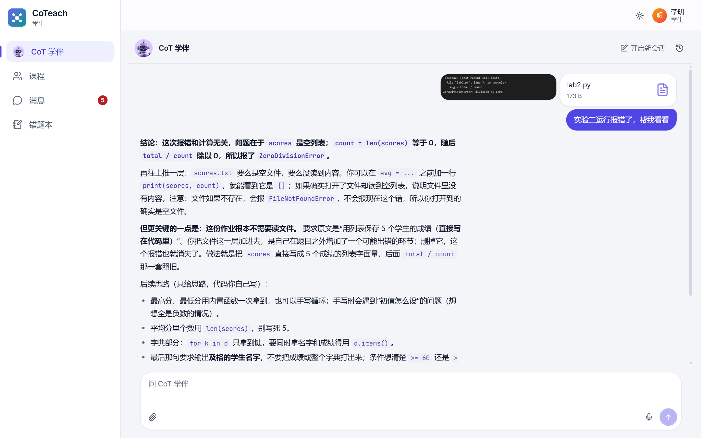
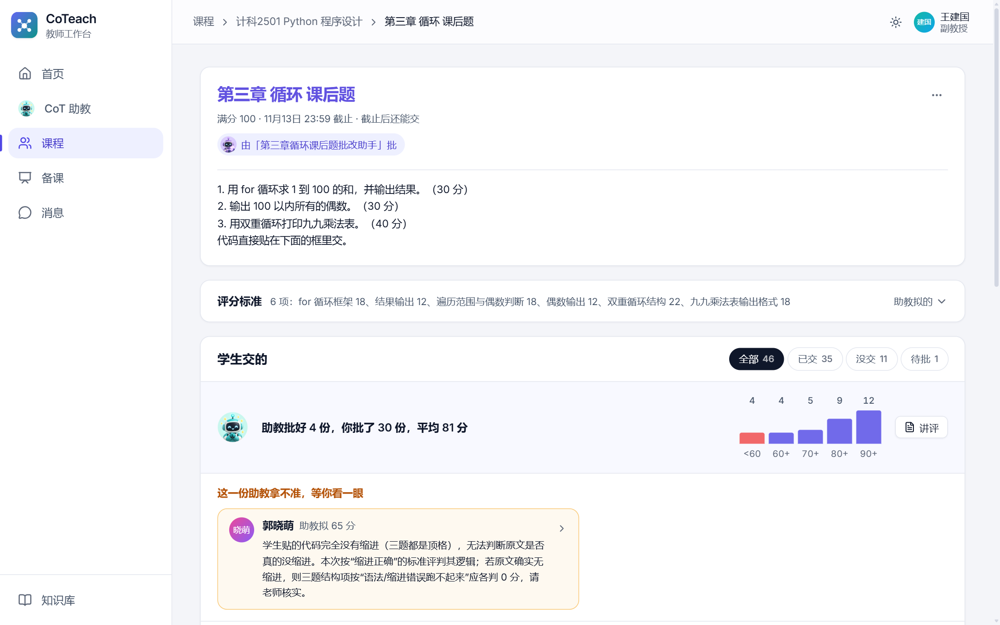
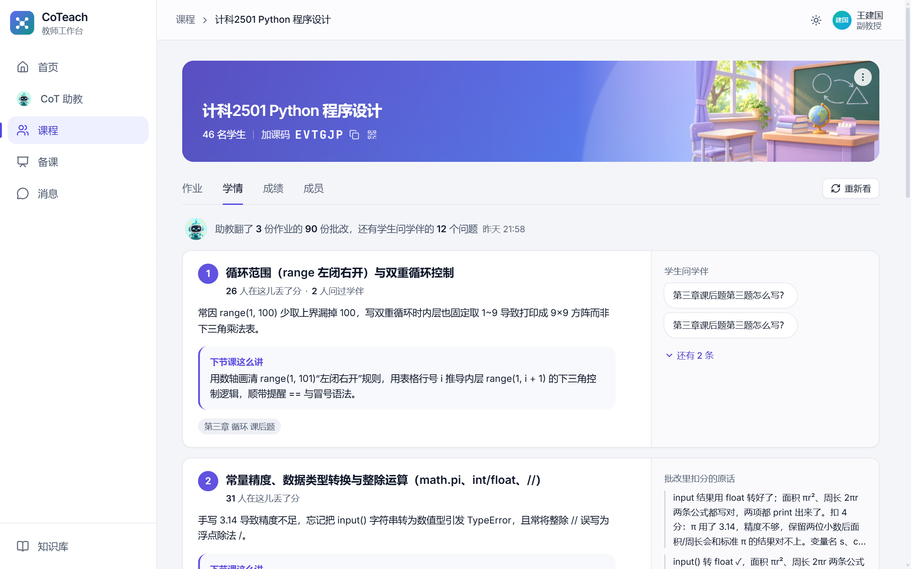

# CoTeach——基于多智能体的师生协同教学平台

第九届传智杯 AI WEB 网页开发挑战赛 · 省赛作品介绍

在线地址：https://teach.haovio.com

## （1）描述项目详情及使用方式

### 1.1 项目简介

高校和高职的老师，除了上课，还要逐个面对学生：答疑，布置和批改作业，写讲评，弄清学生卡在哪里，再准备下一节课。CoTeach 给每位老师配一个 AI 助教（CoT 助教），给每个学生配一个 AI 学伴（CoT 学伴）。老师把资料交进知识库，平时用对话交代工作，具体事务由助教在平台上办理。学生的问题先由学伴回答，需要老师决定的事（如晚交、改分、请假）做成卡片送到老师面前，老师点一个选项，回复就传回学生。

设计上分三方：老师决定课程内容和规则；程序负责固定流程和必须准确的数据，如名单、截止时间、提交情况、总分和权限；AI 只做需要理解和判断的工作，如答疑、批改理由、讲评、学情分析、教案和课件。

### 1.2 使用方式

打开 https://teach.haovio.com ，在登录页选择「登录密钥」，粘贴下面的密钥即可进入：

- 老师（pingwei）：`（见提交给比赛的作品介绍）`
- 学生（pingwei-xs）：`（见提交给比赛的作品介绍）`

老师登录后先到「首页」：中间是一个大输入框，可以打字，也可以点话筒说话，发出后转到 CoT 助教接着对话；输入框下面一行是备课、布置作业、发通知、签到、交资料。左侧栏依次是首页、CoT 助教、课程、备课、消息，知识库在左侧栏最下面。学生登录后先到「CoT 学伴」，左侧栏是 CoT 学伴、课程、消息、错题本。

老师账号里有一门演示课程「计科2501 Python 程序设计」，36 个虚构学生和评委学生账号都在这门课里；4 份作业中交上来的已由助教批完，讲评和学情都能查看；「备课」里有备好的课，包括教案、课件、练习和课后作业。可以试：

- 老师账号：在首页说「实验二以后专门交给一个助手批，没贴运行结果的扣 1 分」或「给计科2501 发起签到，5 分钟」；在「课程」里打开一份作业，看逐项给分和原文批注；在「备课」里放映课件、导出 PPT，或对右侧的助教说「这一页换个例子」。
- 学生账号：在 CoT 学伴里问「老师让装 Python 3.12，怎么装？」「第三章第3题怎么写？」，也可以贴报错截图、带代码文件；问一件要老师决定的事，比如申请晚交、对扣分有疑问，课程规定里写明了的学伴会直接按规定答，拿不准的会转给老师，这时老师账号「消息」的收件箱里出现一张带选项的卡片，老师点一个，学生就收到回复；在错题本里点「练一练」。

比赛期间线上系统关闭了注册。自行部署时，老师用手机号注册，建好课程后把加课码或二维码发给学生，学生用加课码注册加入。

源代码公开在 GitHub：https://github.com/w2697134/CoTeach ，带完整的提交记录。本地运行需要 Node.js 24、pnpm、Git 和一个 DeepSeek API key，按仓库首页说明的步骤约 10 分钟可以跑起来。

### 1.3 主要功能

| 使用者 | 模块 | 内容 |
|---|---|---|
| 老师 | 首页 | 大输入框，说的话交给 CoT 助教办理；下面一行是备课、布置作业、发通知、签到、交资料 |
| 老师 | CoT 助教 | 一句话办事：建课程、布置作业、改分、发通知、签到、选人、查作业情况等；结果以卡片显示在对话里，办错可以撤回，拿不准时用选项卡片问老师 |
| 老师 | 课程 | 学生凭加课码或二维码加入；分作业、学情、成绩、成员四栏。作业由助教按评分标准逐项批改、在原文上标出问题，讲评可下载 Word 或发给学生，成绩可导出 Excel |
| 老师 | 备课 | 说一句备哪节课，可拖入讲义和往年课件；助教做出学情分析、教案、课件、练习和课后作业，课件能放映，能导出 PPT 和 PDF |
| 老师 | 消息 | 收件箱、课程群、私聊；通知看得到谁已读，签到出二维码，随机选人一轮内不重复 |
| 老师 | 知识库 | 交 PDF、PPT、Word、图片、压缩包，助教整理成笔记，原件只读保存；改动像 Word 修订一样显示，可以撤回 |
| 学生 | CoT 学伴 | 答疑，查自己的作业和分数，索取资料，可贴截图、带文件；需要老师决定的事转给老师 |
| 学生 | 课程、消息 | 作业、成绩、成员；课程群、私聊老师、通知和签到 |
| 学生 | 错题本 | 各门课被扣分的题，点「练一练」由学伴出一道类似的新题 |

## （2）描述项目的亮点

1. 用对话办理平台上的事务，办错可以撤回。CoT 助教有三十多个工具，建课程、布置作业、改分、发通知、签到、选人、开始备课都能用一句话办完，结果以卡片形式显示在对话里。
2. 学生的问题逐级处理，老师只回答要拍板的事。学伴拿不准时问助教，需要老师决定的才做成带选项的卡片送给老师；老师定下的规则记进课程资料，以后同类问题学伴照规则回答。
3. 必须准确的数据由程序计算，权限由程序控制。总分、提交人数、截止日期和「下周五」这类日期换算都由程序完成；学生看不到答案、试卷、成绩册和别人的作业，这些限制写在程序里，不靠提示词约束模型。
4. 学情来自真实的作业和提问，并用于下一节课。助教汇总作业中的扣分原因和学生问学伴的问题，按丢分人数列出卡住的知识点；备课时，教案开头的补讲和课件里的错题页都依据这份学情来写。
5. 一句话备出整套课，课件能导出可编辑的 PPT。教案和课件边生成边显示，过满的页由程序查出、交回模型精简；导出时按网页课件上每段文字的位置、字号和颜色生成原生的文本框和形状。
6. 助教会为反复出现的工作分出专门助手。助教发现同一类工作反复出现时向老师提议，老师同意后才创建；专门助手保留自己的会话，老师改过它批的分会记进会话，之后照老师的意思批。

## （3）AI测试技术落地使用情况概述

系统的主要功能依赖大模型，而模型每次的输出不完全相同，所以测试分两类：调用模型的部分，用固定测试集在真实模型上运行，由程序自动判分，每次修改前后对比；不调用模型的部分，用自动化测试，结果可以重复。项目代码借助 AI 编程工具完成，需求、取舍和验收由团队把关，这些测试也用来检查 AI 写的代码。

### 3.1 用固定测试集测模型输出

每个智能体有一套固定测试集，包含固定的数据（课程、学生、作业、知识库）、固定的输入（老师或学生说的话、待批改的答卷）和每条输入的预期结果。测试在数据副本上调用真实模型运行，由程序判分：查数据库看事情是否办成、有没有多改数据，检查回复里有没有泄露参考答案、该转老师的有没有转。每次修改发给模型的说明或更换模型，都在修改前后各跑至少两遍，比较数字，也逐条阅读原始输出。

| 测试集 | 内容 | 主要指标 |
|---|---|---|
| 助教指令 | 老师说的 61 句，含该问老师的、一句办几件、撤回、接上文、专门助手 | 办对几句、办错几处、该问没问 |
| 消息操作 | 通知、签到、补签、选人、群里发言、私聊等 24 句，含语音识别错字 | 办对几句、耗时、有没有多改数据 |
| 学伴问答 | 学生说的 34 句，含索要答案、该转老师的、接上文 | 答对几句、是否泄露答案、该转没转 |
| 批改 | 8 份好坏分明的答卷各批两遍；演示课程 70 份答卷 | 分数区间、两遍分差、分数是否记错了题 |
| 专门助手提议 | 14 组老师的近期操作记录 | 该提的提没提，不该提的提没提 |
| 备课和课件 | 真实备几节课，课件每页放进 1280×720 检查 | 每步用时和成败、过满的页、代码是否折行 |

### 3.2 改前改后对比

| 发现的问题 | 改法 | 改前 → 改后 |
|---|---|---|
| 批改时把分数记到别的题上 | 交分格式改为与评分标准一一对应 | 70 份答卷两遍：16、8 份 → 0、0 份 |
| 学生问题卡片太长 | 去掉拟回复，照助教平时问老师的写法 | 字数中位数 487、414 → 200、191 |
| 学伴把能答的问题转给老师 | 说明课上没讲到的知识点也照常讲解 | 误转 2、2 句 → 0、0 句 |
| 助教把「下周五」算成本周五 | 日期改由程序换算 | 40 句办对 35 → 38、37 |
| 课件页面太满 | 讲解移进讲稿，加一步检查和精简 | 每页字数中位数 231 → 105；过满的页 12/14 → 2/13 |

更换模型也这样比较：学伴问答 34 句，Gemini 答对 33 句，DeepSeek 两遍分别答对 34、33 句。加入专门助手后，原有 53 句没有因新功能出错，新增 8 句全部办对。

### 3.3 其他测试

不调用模型的部分有 265 条自动化测试，覆盖权限、课程和作业流程、打分规则、备课和课件的修改与撤回、知识库的改动与撤回、故障恢复和数据库升级；测试里模型的回答是预先写好的，每次结果相同。

演示课程的答卷也由模型生成：先给 36 个学生各定一个水平（分四档），再安排几人没交、一人照着别人的答卷抄、一人交错了作业，用来检验批改能否给好答卷高分、同样的错误扣分是否一致、抄袭能否被比对出来。每完成一个功能，还用无界面浏览器登录老师和学生账号把流程走一遍并截图核对。上线后用脚本扫描线上的批改记录，演示课程 93 份批改中有 13 份把分数记错了题，就是这样查出来的，修复后全部重批。

## （4）描述项目中涉及的关键技术

### 4.1 技术栈

| 部分 | 技术 |
|---|---|
| 前端 | React 19、Vite、Tailwind CSS 4、TanStack Query；用服务器推送（SSE）把助手的工作进展实时推到页面 |
| 后端 | Node.js 24、Hono；一个数据目录同时只允许一个写进程，启动时恢复中断的任务 |
| 数据 | SQLite（node:sqlite）；每位老师的知识库是一个 Git 仓库，改动、撤回和历史版本由 Git 记录 |
| 模型 | 统一接入 OpenAI、Anthropic、Gemini 三种接口格式，线上使用 Gemini 和 DeepSeek |
| 文件 | 讲评和教案生成 Word（docx），课件导出 PPT（pptxgenjs）和 PDF，成绩导出 Excel |

### 4.2 多智能体分工

| 智能体 | 能做的事 | 程序限制 |
|---|---|---|
| CoT 助教 | 三十多个工具：建课程、布置作业、改分、批改、写讲评、发通知、签到、选人、查知识库、开始备课、分出专门助手、撤回等 | 只能操作这位老师自己的课程和资料 |
| CoT 学伴 | 查自己的作业和分数、发送课程资料包里的文件、向助教求助 | 拿不到答案、试卷、成绩册、名单和别人的作业 |
| 答复学伴的助教 | 查知识库、更新课程资料包、把需要老师决定的事做成卡片 | 不能改课程、作业和成绩，看不到学生交的作业 |
| 专门助手 | 查知识库，批改交给它的作业 | 不能改课程、作业、成绩和名单 |
| 后台任务 | 整理知识库；批改、写讲评和学情；备课 | 整理只在这位老师的知识库内进行，原件只读；作业由老师点击发布 |

各智能体的工作方式相同：调用模型，执行模型选定的工具，把结果交回模型，直到完成；工具用 JSON Schema 描述。对话记录只追加不改写，开头不变，可以命中模型的前缀缓存，过长时把前面的部分压缩成摘要。每门课有一份课程资料包放在上下文最前面，作业的截止时间、满分和要求由程序从数据库取出拼进去。

### 4.3 模型接入和主备切换

接入层统一了三种接口格式的消息、工具调用和流式输出。每次调用配一个主模型和一个备用模型，主模型报错或超时没有输出就换备用模型重做，与人对话的等 1 分钟，后台工作最长等 5 分钟。CoT 助教和 CoT 学伴有人当面等着，先用 DeepSeek（线上平均 3.4 秒回复一句）；批改、备课、整理资料先用 Gemini。我们接入的 Gemini 接口不接受工具调用参数，接入层用结构化输出（json_schema）让模型每一步返回「要说的话」和「要调用的工具」，再转换成标准的工具调用。

### 4.4 批改和课件

- 交分格式由评分标准生成，有几项就有几格；程序检查每项不超过满分，自己算总分；批注要能在学生原文中找到才划线。老师改了某一份的某一项，程序找出有同样问题的其他几份，问是否一起改。
- 相似度按 5 个字一段比较，排除题目原文和多数人都有的写法，只供老师参考，不下结论。
- 模型提交教案和课件时参数是逐字生成的。接入层每 0.3 秒报告一次写到一半的参数，程序补全未闭合的字符串和括号后读出已写好的部分，页面每 1.5 秒取一次，内容边写边出现。
- 课件每页是模型按一套样式写的 HTML，发给模型的样式说明和页面的 CSS 是同一套，放在禁止运行脚本的 iframe 中显示。导出 PPT 时测量每段文字和每个色块，用 pptxgenjs 画成原生的文本框和形状。每次修改保存一个版本，可以撤回。

## （5）项目相关的图片/照片

老师的首页：问候、一个大输入框和一行常用功能，说一句话交给 CoT 助教去办。

学生来问的卡片：学伴拿不准的事转给老师，卡片上写清是谁、问的什么，给出几个选项，老师点一个或者自己回一句。

学生的 CoT 学伴：学生贴上报错截图和代码文件，学伴讲清出错的原因，只给思路，代码让学生自己写。

课程群里的通知卡和签到卡：通知谁读了、谁没读；签到出二维码，列出没签的名单，可以全屏或分屏投到教室大屏上。

一份作业的批改：助教拿不准的那份放在最上面并写明原因，下面是每人的分数。

学情：按丢分人数列出学生卡住的知识点，附扣分原文和下节课的讲法。

一节课的备课页：课件、教案、练习、作业、学情分在几栏，右边是随时可以交代修改的助教。

## （6）项目之前是否发表过或获奖，请说明

没有。

## （7）若项目是在其他项目基础上优化，请说明优化部分

本作品是在团队自己做的第一版教学助手系统（teach-v2）基础上重新开发的。重做时只保留了第一版的界面风格（紫色主题、卡片和 3D 插画），功能和架构全部重写：

- 知识库改为每位老师一个 Git 仓库，由后台的资料整理智能体组织，改动可查看、可撤回；
- 新做了课程、作业、成绩、批改、讲评、学情、备课（含课件放映和导出）、消息、错题本；
- 新做了老师的 CoT 助教、学生的 CoT 学伴，以及学伴、助教和老师之间的传话机制；
- 新做了模型接入层（多种接口格式、主备模型自动切换）和检验模型输出的固定测试集。
