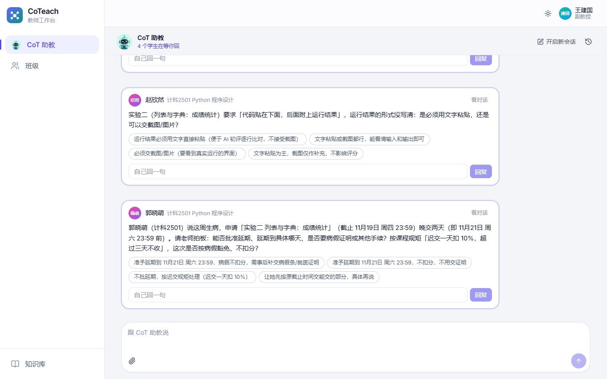
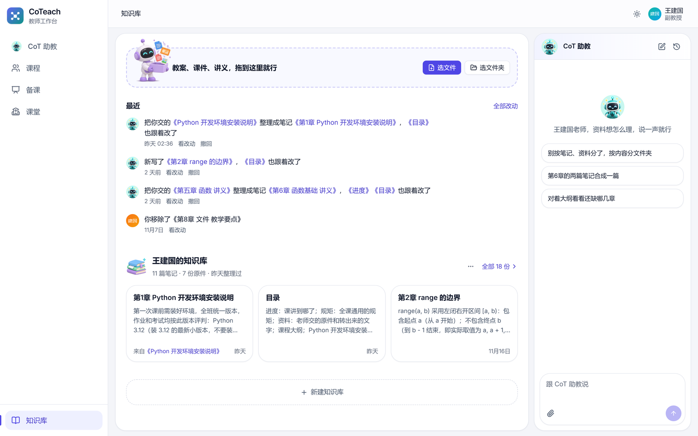

# CoTeach 师生多智能体协同教学系统 · 作品介绍

第九届传智杯 AI WEB 网页开发挑战赛 · 省赛作品

在线体验：https://teach.haovio.com

## 一、项目详情和使用方式

### 1. 做什么

大学和高职老师除了上课，还有一大堆跟每个学生打交道的活：回答学生的问题、布置和改作业、写讲评、看学生卡在哪、备下一节课、期末算分。CoTeach 给每位老师配一个 AI 助教，老师上课把该讲的讲完，资料或安排有变化时跟助教说一声，其余跟每个学生打交道的事由助教做，老师只在要拍板的时候点一下。

学生那边有一个 AI 学伴：答疑、查自己的作业和分数，拿不准的去问老师的助教；要老师定的事（晚交、改分、请假）弹一张卡片给老师，老师回了再转告学生。

### 2. 功能

| 谁用 | 功能 | 做什么 |
|---|---|---|
| 老师 | CoT 助教 | 打开就是一个大输入框，说一句话就办事：建课程、布置作业、改分、发通知、发起签到、随机选人、问作业情况；办成的东西直接摆在对话里（签到二维码、点到的名字、通知谁读了），数字跟着变；办完能撤回；拿不准用选项卡片问老师 |
| 老师 | 知识库 | 老师交的 PDF、PPT、Word、图片、压缩包，助教读出来、整理成笔记，原件只读留着。打开就看得到每份笔记写了什么，最近整理了什么一件一句话；改动像 Word 修订一样显示，能撤回 |
| 老师 | 课程 | 加课码和二维码，学生自己加入；课程页分作业、学情、成绩、成员四栏 |
| 老师 | 消息 | 收件箱：助教的提醒、学生来问要老师拍板的卡片都在这里，处理完划掉，助教的主对话不被刷屏。每门课一个群，能私聊学生。发通知看得到谁读了谁没读，一键提醒，发错了能撤回；签到出二维码和链接，投到大屏上学生扫码就签；随机选人一轮里不重复 |
| 老师 | 批改和讲评 | 助教照评分标准逐项给分、在原文上划批注；改一份能把同样问题的几份一起改；讲评能下载 Word、发给学生 |
| 老师 | 学情 | 学生卡在哪几个知识点，丢分多的在前，几个人丢分、几个人问过学伴，下节课怎么讲 |
| 老师 | 专门助手 | 同一类活反复出现时，助教会提议分出一个专门助手，老师点「分出来」就有了；它的会话一直留着、下次接着用；作业可以交给它批，老师改过的分它会记住 |
| 老师 | 备课 | 说一句备哪门课、讲什么、几分钟，也可以把教材、讲义、去年的课件直接拖进来，助教照着备，文件同时存进知识库。助教分几手做出学情、教案、课件、课堂练习、课后作业。课件每页是一张幻灯片，能放映，能导出 PPT 和 PDF；能直接改，也能跟助教说着改，改错了能撤回；课后作业点一下发到班里。备的时候边做边显示：教案一段段写出来，课件一页页冒出来，顶上一句话说现在做到哪了 |
| 学生 | CoT 学伴 | 答疑、查作业和分数、要资料；要老师定的事转给老师 |
| 学生 | 消息 | 课程群、私聊老师；收件箱里是通知和签到，点开就算读了，签到点一下或扫码 |
| 学生 | 错题本和练一练 | 各门课丢了分的题；点「练一练」，学伴照这道题出一道新题，做完帮着判 |

### 3. 怎么用

**在线体验**：打开 https://teach.haovio.com ，在登录页点「登录密钥」，贴上下面的密钥就能进。给评委准备了一个老师号、一个学生号：
- 老师（pingwei）：`（见提交给比赛的作品介绍）`。里面有一个建好的班「计科2501 Python 程序设计」，36 个虚构学生、交上来的作业助教已经批好，讲评、学情都能看；「备课」里有备好的课（教案、课件、练习、作业），课件能放映、导出 PPT。可以跟 CoT 助教说一句话办事，比如「实验二以后专门交给一个助手批，没贴运行结果的扣 1 分」。
- 学生（pingwei-xs）：`（见提交给比赛的作品介绍）`。在 CoT 学伴里问「老师让装 Python 3.12，怎么装？」「第三章第3题怎么写？」，看它怎么照老师的资料带；错题本里能「练一练」。

**代码**：https://github.com/w2697134/CoTeach ，公开仓库，带完整的提交记录。

自己部署的版本用账号密码登录：老师用手机号注册，新建课程后把加课码给学生，学生在登录页用加课码注册加入。

一个完整的流程：
1. 老师跟 CoT 助教说「给这门课布置一份作业：用 for 循环求 1 到 100 的和，满分 10 分，明天交」。
2. 学生交作业，助教几十秒内批完，学生看到分数和批注。
3. 学生在 CoT 学伴里问「我第1题为什么扣分」「能晚交两天吗」。晚交这种事会弹到老师那边，老师点一个选项就回复了。
4. 老师在课程的「学情」里看学生卡在哪；到「备课」说一句备哪节课，把讲义拖进去，助教照着做出教案、课件和练习。
5. 上课前跟助教说「发起签到，5 分钟」，对话里出一张签到二维码，放大投到屏幕上，学生扫码签到，人数实时涨；「随便点一个人」，名字直接出来。

**本地运行**（README 里有完整的 10 分钟复现指南）：装好 Node.js 24、pnpm、Git，`pnpm install`，在 `server/.env` 填一个 DeepSeek 的 key，`pnpm dev:server` 和 `pnpm dev:web` 两个终端，浏览器打开 http://localhost:5190 。放一个 `seed-demo.json` 能自动建一个有 36 个学生、4 份作业的演示班。

## 二、项目亮点

1. **几个智能体分工协作，老师只在要拍板的地方出现**。老师的 CoT 助教、后台的整理助手、学生的 CoT 学伴、替老师回学伴的助教、后台批改和备课的助教，各有各的工具和边界。学生问学伴，学伴问助教，助教问老师，老师点一下，回复一路传回学生；老师定过的规矩记进课程资料包，下次同样的问题直接照规矩答。
2. **要准的东西程序算，模型只写需要理解的部分**。总分、几个人交了、几个人丢分、截止日期、谁能看到什么都由程序算。学生看不到答案、试卷、成绩册和别人的作业，也由程序拦住，不靠提示词。
3. **改提示词先量再改**。每一次改发给模型的话，都先用「尺子」（固定的题目、固定的数据、跑真模型）量改前改后，每组跑两遍，数字和原文都看，记在提示词账里。几个例子：
   - 批改交错题的份数从 16/70 降到 0/70；
   - 学生来问的卡片从约 450 字降到约 200 字；
   - 学伴不该转给老师的问题从 2 句降到 0 句。
4. **说一句话就能办，办完能撤回**。建课程、布置作业、改分、通知学生都能跟助教说一句话办完，办错了说「撤回」就改回去；知识库的改动也一样。
5. **学情和备课把教学闭环接起来**。学生问学伴的问题和作业里丢分的地方，汇成学情；学情又进了下一节课：教案开头的补讲、课件里的错题页都照它来。
6. **助教会给自己分出专门助手**。程序数着老师最近改了几次分、回了几次学生的问题、跟助教说了多少句，到了一定次数就让助教回头看看；像是同一类活反复出现、每次照同一套做法办，助教就提议分出一个专门助手，老师点「分出来」才分：起名字，写好它管什么、怎么办。以后这类活交给它，它接着自己的会话办，越办越熟；老师改过它批的分，这件事记进它的会话，下一份就照着老师的意思批。原理就是开一个子代理、留着它的会话，用的时候接着往下走。
7. **助教干活看得见**。备课时不用干等：模型写教案、写课件、出题的时候，写到一半的内容就摆到页面上，页面自动翻到正在做的那一份、跟着往下滚；顶上钉着一句助教说的话，比如「教案写到「新知讲授」这一段了」「课件排好 10 页了，一共 24 页」「有 13 页字太多，我在删减」。模型想好了一口气写完的那几步，就照实说一般要多久，不假装在一页页出来。
8. **课件是模型写的网页，能导出成能改的 PPT**。每页幻灯片是模型照一套课件样式写的一段 HTML，页面、放映、导出用的是同一份。导出 PPT 时量出页面上每段字的位置、字号和颜色，做成能改字的文本框和形状，不是贴截图。做完以后程序量每一页：字数、条数、代码行，代码行在那一栏放不放得下；太满的页交回去删到只留要紧的，细节挪进讲稿。
9. **模型可换、能自动顶上**。默认用服务器上的 Gemini 4 Hydrogen，出错或一直没动静就自动换 DeepSeek。那个接口本来不支持工具调用，我们在接法里用结构化输出把它补上，上层代码不用改。

## 三、AI 测试技术的落地情况

1. **模型输出的质量用「尺子」测**。在 `tools/` 下有几把尺子，每把在复制出来的一份数据里跑真模型、自动判对错：

   | 尺子 | 测什么 |
   |---|---|
   | ta-measure | 老师说的 61 句：办对、办错、该问没问（其中 8 句专门助手：该分的分、不该分的不分、有了就交给它） |
   | stu-measure | 学生说的 34 句：答对、漏没漏答案、该转老师没转、卡片多长 |
   | grade-measure | 8 份好坏分明的答卷各批两遍：分数段、稳定性、漏没漏参考答案 |
   | grade-map | 演示班 70 份答卷：交分有没有交错题 |
   | suggest-measure | 助教该不该提议分专门助手：该提的提、不该提的不提 |
   | prep-measure | 真备几节课：每手用时、做没做成、教案环节和分钟、课件页数和版式、字多的页、题型、作业总分、选择题有没有答案 |
   | slide-measure | 课件每页照页面的画法放进 1280×720：放不放得下、要缩小多少、代码折不折行、字太小的页，再拼一张总览图给人看 |

   每次改提示词或换模型都跑，改前改后对比。比如换成 Gemini 4 Hydrogen 后，学伴 34 句对 33 句，跟原来的 DeepSeek 一样；批改 70 份由 Hydrogen 批，出错时自动换 DeepSeek 顶上。加专门助手前后也各量了一遍：原来的 53 句没有改坏，新的 8 句全对。课件加了「精修」这一步以后，内容页每页字数的中位数从 231 降到 105，程序量出来太满的页从 14 页里 12 页降到 13 页里 2 页。

2. **不调模型的部分用自动测试**。265 条测试覆盖权限、课程和作业流程、打分规则、备课和课件的改动与撤回、知识库改动和撤回、故障恢复、数据迁移。模型的回答在测试里是写好的，每次结果一样，改代码后跑一遍就知道有没有改坏。

3. **测试数据由 AI 按学生水平生成**。演示班 36 个学生的答卷，是先给每个学生定一个水平（分四档），再安排几个没交的、两个抄袭的、一个交错作业的，让模型照着写出来的。这些答卷用来测批改：好的分数要高、同样的错要扣一样的分、抄的要被比出来。

4. **AI 自己走一遍界面**。每做完一块，AI 用无界面浏览器分别登录老师和学生账号，把流程从头到尾点一遍并截图核对，再交给我们验收。

5. **线上数据的体检**。上线后用脚本扫线上批改的数据，比如「某一项的理由先提到的是别的题」，用来发现批改交错题这类问题。演示班 13 份批错就是这样查出来、修好、重批的。

6. **页面上的字也量**。无头浏览器打开老师和学生的 18 个常用页面，量每页用了几种字号、一行多少个字、灰字跟底色的对比度、句子中间夹没夹「1）2）」这种编号。改前一行最长 73 个字、浅灰字对比度约 3:1、一页最多 12 种字号；改后一行不超过 44 个字左右，字的对比度都在 4.5:1 以上，只用整数字号。

## 四、关键技术

- **前端**：React 19、Vite、Tailwind CSS 4、TanStack Query；服务器推送（SSE）让助手一边干活一边把工作记录推到页面上。
- **后端**：Node.js 24、Hono、SQLite（node:sqlite）。每位老师的知识库是一个 Git 仓库，改动、撤回、历史都靠 Git；一个数据目录只允许一个写进程。
- **智能体**：各自一个「调模型 → 用工具 → 看结果 → 再调模型」的循环，工具用 JSON Schema 描述。对话记在数据库里只往后加，前面不变，命中模型的前缀缓存；太长了压成概要。
- **模型层**：统一 OpenAI、Anthropic、Gemini 三种写法，主模型加备用模型。主模型出错或超时没动静就换备用模型，等多久按场景定（跟人对话 1 分钟，后台活 5 分钟）。不支持工具调用的接口，用 json_schema 让模型交「要说的话」和「要用的工具」，再拆成工具调用。
- **专门助手**：每个专门助手一段只往后加的会话；交给它的活接着这段会话办。批作业这种一份一份来的，每份从它的会话往下接着批，批的那一份不留在会话里（不然越批越长、前面的带偏后面的），只把老师改过的分记进去。
- **结构化打分**：交分的格式就是评分标准本身（几项就几格），程序校验每项不超过满分、自己加总分；批注在原文里定位（不管空格换行）。
- **相似度**：5 字一段比较哪几份很像，排除题目原文和全班都有的写法；只给老师参考，不下结论。
- **课件**：每页一段 HTML，照一套课件样式写（发给模型的样式说明和页面上的 CSS 是同一套）；放在不许跑脚本的 iframe 里显示，存之前程序再清洗一遍。字多了整页等比缩小；代码一行放不下先把代码的字缩小，不折行。导出 PPT 用 pptxgenjs，量出页面上每段字和每个色块，画成原生的文本框和形状。
- **备课分几手**：学情、教案先做，课件和题目两手同时做，最后核对一遍。
- **边做边显示**：模型用工具交教案、课件、题目时，参数是一个字一个字写出来的；接模型那一层每 0.3 秒把写到一半的 JSON 报一次，程序补上没写完的字符串和括号读出已经写好的部分，放在内存里，页面 1.5 秒取一次。每次改动存一版，能撤回；跟助教说着改的，改了内容的那几页再补做样子，撤回一次就都回去。
- **文档生成**：讲评和教案生成 Word（docx）。
- **日期**：「下周五」「往后推两天」这类说法由程序换算，不让模型心算。

## 五、项目图片

老师打开就是 CoT 助教的首页：一句问候、一个大输入框，下面几句照老师自己的课现编的话，点一下就填进去；发出去就接着聊：

学生来问的卡片：学生是谁、问的什么、几个选项，点一下就回：

知识库：拖资料的地方，最近整理了什么一件一句话，每份笔记写了什么：

消息：每门课一个群。跟助教说「发起签到」「随便点一个人」，或者自己点下面的按钮，群里出签到卡（二维码、签了几个、谁没签）和选人卡：

签到二维码点一下全屏，投到教室的屏幕上，学生用手机扫码就签上，人数跟着涨：

课程：每份作业一张卡片，一人一个小方块，一句话说谁没交、哪份要老师看：

一份作业：助教拿不准的那份放在最上面，下面一人一格摆分数：

课程里的学情：

备课框里可以直接拖进讲义、课件，助教先读，照着备：

备课：边做边显示，顶上钉着一句助教说的话，课件做好一页换一页：

课件：每页是一张幻灯片，能直接改字、跟右边的助教说着改，能放映、导出 PPT：

学生的错题本：

学生的 CoT 学伴：

## 六、以前是否发表过或获奖

没有。

## 七、是不是在别的项目上优化的

是在我们自己的第一版 teach-v2（2026 年 9 到 10 月）上推倒重做的。2026 年 11 月 5 日起重做，只留了第一版的界面风格：紫色主题、卡片和 3D 插画。功能和架构全部重写：
- 知识库改成每位老师一个 Git 仓库，由整理助手组织；
- 新做了课程、作业、成绩、批改、讲评、学情、备课（含课件和放映、导出）、错题本；
- 新做了老师的 CoT 助教、学生的 CoT 学伴，以及它们之间传话的桥；
- 新做了接模型的那一层（主备模型、Gemini 接口），以及测质量的尺子。

开发过程（每一步的提交记录、跟 AI 的对话、提示词账）都在作品文件里。
