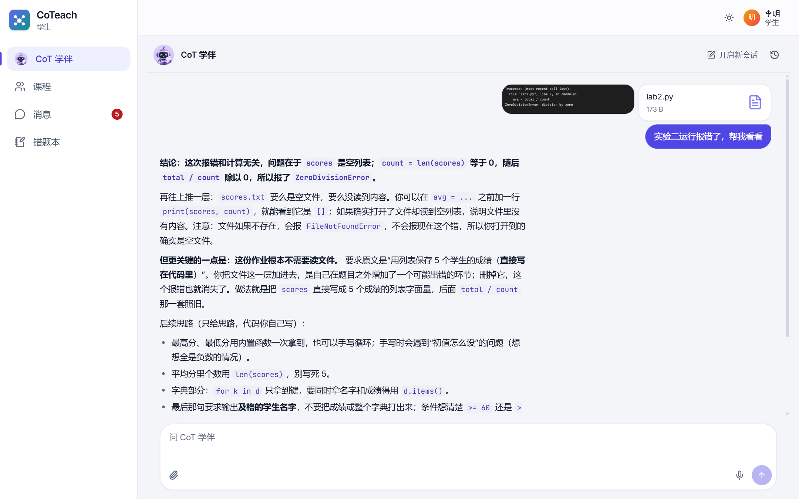

# CoTeach——基于多智能体的师生协同教学平台 · 技术文档

第九届传智杯 AI WEB 网页开发挑战赛 · 省赛作品

在线体验：https://teach.haovio.com　代码仓库：https://github.com/w2697134/CoTeach

## 一、概述

### 1.1 要解决的问题

高校和高职老师的工作，除了讲课，还有很大一部分是和每个学生单独打交道：回答问题，布置和批改作业，写讲评，了解学生卡在哪里，准备下一节课，统计成绩。这部分工作随学生人数增加，内容又高度重复。

CoTeach 给每位老师配一个 AI 助教（CoT 助教），给每个学生配一个 AI 学伴（CoT 学伴）。老师用一句话交代事情，助教调用系统已有的功能去办，办过的事可以撤回。学生的日常问题由学伴按课程资料回答；需要老师决定的事，以带选项的卡片送进老师的收件箱，老师选一项，答复再传回学生。

系统按下面的分工设计，后面各章的做法都以它为准：

| 角色 | 负责的事 |
|---|---|
| 老师 | 课程内容和规矩，需要拍板的决定 |
| 程序 | 固定流程和要求准确的数据：课程与名单、截止时间、收作业、分数加总、成绩册、统计数字、权限 |
| 模型 | 需要理解和判断的部分：答疑，按评分标准评判，写评语、讲评和学情分析，整理资料，写教案和课件 |

### 1.2 系统组成

| 部分 | 说明 |
|---|---|
| 前端 | 单页应用，老师和学生共用一套代码，按角色显示不同页面 |
| 服务端 | 一个 Node.js 进程，提供 JSON 接口和 SSE 推送，同时托管前端静态文件 |
| 智能体 | CoT 助教、代答助手、批改助手、备课助手、整理助手、专门助手、CoT 学伴，各有自己的说明和工具（第四章） |
| 模型层 | 统一接入 Gemini 和 DeepSeek，负责主备切换、流式输出和工具调用（第五章） |
| 存储 | SQLite 数据库；每个知识库一个 Git 仓库；上传的文件存在数据目录 |
| 读资料线程 | 在 worker 线程里解析 PDF、Office 文档、压缩包等，单个文件出错或超时不影响主进程 |

### 1.3 架构图

```
浏览器：React 19 单页应用
  老师：首页 / CoT 助教 / 课程 / 备课 / 消息 / 知识库
  学生：CoT 学伴 / 课程 / 消息 / 错题本
  │
  │  HTTPS：JSON 接口；SSE 推送对话文字和工作记录
  ▼
服务端：Node.js 24 + Hono（单进程）
  ├─ 业务接口
  │    账号登录、课程、作业与成绩、消息、知识库、备课
  ├─ 智能体
  │    CoT 助教、代答助手、批改助手、备课助手
  │    整理助手、专门助手、CoT 学伴
  ├─ 后台队列：批改、评分标准、课程资料包、读资料
  ├─ 模型层 llm/：统一格式、主备切换、流式输出、工具调用
  ├─ 读资料线程（worker_threads）
  ├──▶ 数据目录
  │      SQLite 数据库（node:sqlite，WAL 模式）
  │      知识库：每个库一个 Git 仓库
  │      上传的文件、应用密钥
  └──▶ 外部服务
         Gemini、DeepSeek：大模型
         阿里云百炼：语音识别（可选）
```

老师界面上只有一个 CoT 助教，学生界面上只有一个 CoT 学伴，其余几个智能体在后台工作。CoT 助教替老师办课程、作业、批改、成绩、消息这几类事时，调用的是页面本身使用的那套业务接口，经过同样的权限检查：老师在页面上做不了的事，助教也做不了。

## 二、技术栈与部署

### 2.1 技术栈

| 层 | 选型 | 用途 |
|---|---|---|
| 前端 | React 19、React Router、Vite、Tailwind CSS 4、TanStack Query、zustand | 页面、路由、构建、样式，接口数据的缓存与轮询；EventSource 接收 SSE 推送 |
| 内容渲染与导出 | react-markdown、KaTeX、highlight.js、Mermaid、pptxgenjs、uqr | Markdown、公式、代码高亮、流程图；课件导出可编辑的 PPT；二维码 |
| 服务端 | Node.js 24、Hono、zod | HTTP 接口与参数校验 |
| 数据库 | SQLite（Node 内置的 node:sqlite） | WAL 模式，迁移在启动时自动执行 |
| 知识库版本管理 | Git | 每个知识库一个仓库，改动、撤回、历史都基于提交 |
| 资料解析 | unpdf、mammoth、word-extractor、JSZip、SheetJS、7z-wasm | 读取 PDF、Word、PPT、Excel 和压缩包，在 worker 线程里运行 |
| 文件生成 | docx、SheetJS | 讲评和教案导出 Word，成绩册导出 Excel |
| 大模型 | Gemini、DeepSeek | 经统一模型层接入，互为主备 |
| 语音识别 | 阿里云百炼 | 可选，没有配置时页面不显示话筒 |
| 语言与构建 | TypeScript（严格模式）、esbuild | 前后端类型检查，服务端打包成单个文件 |

### 2.2 运行方式

开发时前后端分开运行：Vite 开发服务器监听 5190 端口，把 `/api` 转发到后端的 18660 端口，后端用 tsx 直接运行 TypeScript 源码。

生产环境执行 `pnpm build`：Vite 把前端打包到 `server/dist/web`；esbuild 把服务端打包成一个 ESM 文件，读资料线程单独打包，7-Zip 和 PDF 解析需要的 wasm、字形表一起复制进 `dist`。部署时只需要 Node.js 和 Git，不需要 `node_modules`。

服务启动时依次做这几件事：

1. 用操作系统文件锁占住数据目录。同一个数据目录只允许一个写进程，第二个进程会直接退出并说明原因。
2. 按顺序执行还没执行过的数据库迁移（`server/src/db/schema.ts`，共 28 次）。每次迁移在一个事务里完成，执行过的记在 `_migrations` 表。
3. 首次启动时创建超级管理员，随机生成初始密码，写进权限为 600 的文件；按环境变量登记模型服务。
4. 处理上次停机时没做完的事：批改队列、评分标准、课程资料包、读资料这几类排队任务接着做；正在进行的对话和备课标记为中断，页面提示重说一遍或重做那一步。

### 2.3 线上部署

线上是一台 Linux 服务器，由 systemd 管理一个 Node.js 服务进程，以单独的服务账户运行。服务只监听本机端口，对外的 HTTPS 由前面的反向代理转发。程序目录和数据目录分开，数据目录里是数据库、知识库仓库、上传文件和应用密钥。发布新版本的流程见 7.4。

### 2.4 代码结构

```
server/src/
  app.ts、index.ts     接口装配；启动、迁移、恢复中断的任务
  auth.ts、login-keys.ts、routes/   会话、登录密钥、登录与管理接口
  assistant/   CoT 助教、CoT 学伴、代答助手、专门助手、课程资料包、学生与老师之间的转达
  grading/     评分标准、批改队列、讲评、学情、相似度
  prep/        备课：教案、课件、题目、幻灯片、精修、核对、说着改
  classes/     课程（代码沿用 classes 这个名字）、名单、作业、成绩册
  messages/    收件箱、课程群、私聊、通知、签到、选人
  kb/          知识库（Git 仓库）、交资料与读资料、整理助手
  llm/         模型层：协议适配、主备切换、流式、写到一半的 JSON 解析
  db/          SQLite 封装和迁移
  voice.ts     语音识别
server/tests/  自动化测试
web/src/       前端：pages 按功能分目录，components/deck 是课件的编辑、放映和导出
tools/         模型输出质量评测、演示答卷生成、登录密钥批量发放
```

## 三、功能模块

### 3.1 首页与 CoT 助教

老师登录后先到首页：一句问候，一个大输入框（可以打字，也可以点话筒说话），下面一行常用功能按钮：备课、布置作业、发通知、签到、交资料。按钮直接打开对应的操作；输入框里写的话发给 CoT 助教，页面转到助教的对话里接着办。

CoT 助教是老师用自然语言办事的入口，比如「给计科2501 布置第四章作业，下周五交」「张浩然那题改成 25 分」「第三章交了几个人」。它有 38 个工具（见 4.1）。

- 办成的事以卡片显示在回复下面，卡片上有「撤回」。撤回时程序先检查这条数据后来有没有被改过，改过就不动，避免冲掉老师后来的修改。
- 老师的话对不上、有不止一种理解、或者缺少关键信息时，助教不猜，用选项卡片问老师，一次最多问 4 个问题，最可能的选项排在第一个。老师选完，助教接着办。
- 签到、选人、发通知办完后，卡片上直接显示结果：签到二维码和已签人数、点到的名字、通知读了几个，数字随数据刷新。
- 老师可以给助教发文件，要整理进知识库的，助教交给后台的整理助手。给学生重置密码时，新密码只显示在老师的卡片上，不交给模型。
- 后台的整理、批改、备课不占用对话。整理和批改做完后，结果在助教下一轮带给它；备好的课在「备课」里查看。
- 可以开新会话，旧会话留在历史里，能翻回去接着说。新会话还没开始时，页面上摆出问候、输入框和几句建议，建议由程序按老师现有的数据生成，比如有几个学生在等回复、最近的一门课。

老师的首页：问候、大输入框和一行常用功能按钮：


### 3.2 课程与作业

课程页分作业、学情、成绩、成员四栏。

建课程只需要起名字，系统生成 6 位加课码（不含 0、O、1、I 这类容易看错的字符）、二维码和邀请链接。学生扫码、点链接或输入加课码，填学号和姓名自己加入；还没有账号的在加入时同时注册，账号名就是学号。老师手上有教务名单的，可以导入 Excel 或粘贴文字，名单只用来核对谁还没加入。老师可以换加课码、停止加入、给学生重置密码、导出名单；学期结束后归档，归档的课程只能查看。

布置作业时填标题、要求、附件、满分、截止时间、截止后是否还收、定时发布时间，可以一次发给几门课。每份作业选一种批改方式：助教批完直接发给学生（默认）、批完等老师发布、不用助教批。学生交文字和文件，截止前可以改，截止后还收的标为迟交。老师可以退回让学生重交，重交后原来的分数清空，重新排队批改。

课程页的作业栏：每份作业一张卡片，一人一个小方块表示状态（批好、不及格、在批、助教拿不准、没交），下面一句话写明谁没交、哪份要老师看：


### 3.3 批改

1. 评分标准。作业布置后，批改助手在后台拟评分标准：先到老师的知识库里找题目和参考答案，找不到再自己写。每一项有分值、给分办法和参考答案，各项加起来必须正好等于满分，否则程序退回让它改。老师可以直接修改，改过的以老师的为准；作业满分改了，各项分值按比例调整。评分标准里有参考答案，学生看不到。
2. 排队。学生一交就进批改队列，默认同时批 6 份，服务重启后接着批。批改前，程序把学生交的文字和每个附件读成一段批改稿（图片里的字请模型识别），之后批注的位置都按这段文字算。
3. 交分。批改助手只有一个工具 `submit_grade`，它的参数结构由评分标准生成：评分标准有几项就有几个格子，格子名就是项名，每格填得分和理由；另外交批注（从原文摘一小段，标「有问题」或「写得好」，写说明）、评语，以及需要老师看的原因。
4. 校验。程序把每项得分限制在 0 到该项满分之间并取到 0.5 分，总分由程序相加；缺了哪一项就退回让模型补。批注先在原文里原样查找，找不到再忽略空白查找，仍找不到的只留文字、不划线。
5. 发布。批改方式为直接发布、没有「要老师看」的原因、学生没有重交、老师也没自己批过的，程序把结果写到学生的作业上；其余的留给老师。老师可以改任意一项的分。改了一项后，程序找出这一项助教给了同样分数、老师还没改过的其他学生，连同助教当时写的理由列出来，老师勾选后一起改。
6. 相似度。程序把每份作业去掉空白和标点后切成 5 个字一段，去掉题目里本来就有的段和三成以上同学都有的段，再两两计算重合比例，达到 70% 的列给老师参考。系统只显示两份「很像」和比例，不判断谁抄了谁。

一份作业的批改页：作业要求、评分标准（助教拟的，可以改）、这份作业由哪个专门助手批、分数分布，助教拿不准的那份放在最上面并写明原因：


### 3.4 讲评、学情与成绩

老师在讲评页点「让助教写讲评」或者跟助教说一声，就生成这份作业的讲评。交了几份、平均分、分数段、每项得分率、谁没交、哪几份很像，这些由程序算；常见错误的归类、错因、下节课怎么讲、写得好的例子，由批改助手写。讲评可以下载 Word。老师点「发给学生」后，学生看到的版本里，同学的名字都被程序替换成「有同学」，这份讲评同时写进课程资料包，学伴以后答疑能参考。

学情在老师点「重新看」或者备课需要时生成，材料由程序准备：这门课每份已批作业的每一项有几个人丢分、平均得几分、扣分理由举例，以及学生问学伴的原话，每一条带编号。批改助手把它们归成几个知识点，每个知识点写卡在哪里、下节课怎么讲，并列出依据的条目编号。几个人丢分、几个人问过，由程序按编号去数，编号对不上的不算，丢分多的排在前面。学情页只说学生卡在哪里，不显示具体是谁，也不给学生贴标签。

课程的学情栏：每个知识点写明多少人在这里丢了分、几个人问过学伴、下节课怎么讲，旁边是学生问学伴的原话或批改里扣分的原话：


成绩册列出每个学生每份作业的分数和状态（未交、缺交、待批、已退回），平均分按百分制计算，缺交的计 0 分，可以导出 Excel。成员栏列出名单和加入情况，老师可以打开某个学生和学伴的对话记录，但只能看到涉及自己课程的那几轮。

### 3.5 备课

在备课页选一门课，写一句要求（讲什么、多少分钟），可以把教材、讲义、去年的课件拖进备课框，一次最多 20 份，支持 PDF、PPT、Word、图片、文本和代码文件。也可以在 CoT 助教里说一句「给计科2501 备下节课」。备课分几步完成，页面上能看到每一步的状态：

1. 资料：带了文件的，文件按交资料的流程存进老师的知识库并读出文字，作为「老师这次给的材料」交给后面几步。几份文件合计不超过 3 万字，短的整份给，长的平分剩余字数，截掉的部分注明还有多少字。
2. 学情：这门课的学情没看过或者已经过时的，先生成一次，和读资料同时进行。
3. 教案：参照老师知识库里的教案、课件、授课计划和这次的材料，写教学目标、重点难点、开头补讲（针对学情）、各环节和分钟数、板书设计。
4. 课件和题目：两步同时做。课件先定每页内容（版式、标题、要点、代码、对比、步骤、提问、表格、讲稿），再把每页写成一段 HTML 幻灯片。题目包括练习题和课后作业，课后作业每题带分值和给分办法。
5. 核对：模型把整节课再读一遍，检查答案、代码的预期输出、课件和题目是否与教案一致，发现错误用修改工具改掉。这一步不实际运行代码。

某一步失败只标在这一步上，显示原因，可以单独重做。教案是后面几步的前提，教案没写成时整节课停下。

备课框里可以带文件：


备课过程边做边显示，做法如下：

- 模型用工具交教案、课件、题目时，参数 JSON 是逐字流出来的。OpenAI 写法的适配器每 0.3 秒把写到一半的参数报一次，这只是预览，出错时照样重试或换备用模型。
- 程序解析写到一半的 JSON：停在字符串中间就把字符串补完，否则退回最近一个完整的值，再补齐括号。
- 读出的教案段落、课件页、题目先放在内存里，页面取这节课时一起返回；幻灯片每做好一批就存进课件。生成期间页面每 1.5 秒取一次，自动翻到正在做的部分，顶部固定一行进度说明，比如「课件排好 15 页了，一共 21 页」。
- 有些步骤模型是想好后一次写完的，这时页面只显示这一步一般要多久，不模拟逐页出现。

课件的做法：

- 做成幻灯片：内容定了以后，按一套课件样式把每页写成 HTML，5 页一批、两批同时做。发给模型的样式说明和页面渲染用的 CSS 使用同一套类名。
- 精修：程序测量每一页的可见字数、条目数、代码行数、表格行数、卡片数，以及代码行在所在栏里放不放得下。超过阈值的页（比如字数超过 150、条目超过 6 条、代码超过 10 行）交回模型精修一轮：只留学生要看的几句，其余挪进讲稿。程序只告诉模型哪里太满，不把阈值写给它。
- 显示：每页放在不允许运行脚本的 iframe 沙箱里；存之前服务端先清洗 HTML，去掉脚本、事件属性和外部资源。字多时整页等比缩小；代码一行放不下时先缩小代码字号，不折行。
- 导出：导出 PPT 时把每页按 1280×720 画出来，测量每段文字和色块的位置、字号、颜色，用 pptxgenjs 生成原生文本框和形状，导出的 PPT 可以继续编辑，讲稿写进备注。导出 PDF 走浏览器打印。教案可以下载 Word。

备好以后，老师可以在页面上直接改字，也可以在右边的助教栏打字或说话，比如「第 5 页换个例子」，助教用改教案、改某页、插页、删页、改题这些工具修改。助教栏会带上老师当前看的位置，比如「课件 · 第 3 页」。每次修改保存一个版本，可以撤回；说着改时改了内容的页会重新生成幻灯片，并进同一个版本，撤回一次全部回去。

课后作业由老师点「发作业」发到课程里：作业要求就是题目，评分标准按题生成（每题一项，带参考答案），学生交上来照它批改。

一节课的页面：标题下面是这节课带的讲义，课件可以放映、导出、发作业；老师在右边的助教栏里让它换掉某一页的例子，改完可以撤回：


### 3.6 消息

老师和学生都有收件箱、课程群和私聊。消息功能全部由程序实现，不经过模型；CoT 助教替老师发通知、签到、选人时，调用的也是这些接口。

- 收件箱：学生来问需要老师决定的卡片、助教关于分出专门助手的提议、一份作业批完一批的消息（几份要老师看、几份没批成）、作业一天内截止还有人没交的提醒（每份作业只提醒一次）都进老师的收件箱，不占用和助教的主对话。卡片在收件箱里就能回答；点开算已读，处理完划掉。学生的收件箱里是通知和签到。
- 课程群：每门课自动有一个群，成员是老师和这门课的学生，可以发文字和文件。
- 私聊：同一门课里的老师和学生之间可以私聊，学生之间不能私聊。
- 通知：可以一次发给几门课，每个课程群出一张通知卡，每个学生的收件箱来一条。老师能看到读了几个、谁没读，可以一键提醒没读的学生（那一条在学生收件箱里重新置顶），也可以撤回；撤回后群里留一行提示，学生收件箱里的那条删除。
- 签到：老师发起签到并设定时长（默认 5 分钟），群里出一张签到卡，带二维码和链接。学生点卡片、扫码或打开链接都能签，过了时间签不上；老师可以给没签的学生补签，也可以提前结束。签到卡打开时每 2 秒刷新人数。二维码可以全屏投到教室的屏幕上；也可以打开分屏小窗，用浏览器的画中画窗口浮在其他窗口（比如 PPT 放映）上面，只显示二维码、倒计时和人数，浏览器不支持画中画时换成网页内可拖动、可调大小的浮窗。
- 选人：在一门课里随机点一个学生，一轮内不重复，点完一轮开新一轮，群里出一张卡。随机数用 Node 的 `crypto.randomInt`。

课程群里的通知卡（已读人数、没读的人、提醒、撤回）和签到卡（二维码、全屏、分屏、补签）：


### 3.7 知识库

每位老师可以建多个知识库，能改名，清空后能删除，文件可以在库之间移动。

交资料时把文件或整个文件夹拖进来，大文件按 8 MB 分块上传，中途可以取消。能读的格式：

- 文档：Word（docx、doc、odt、rtf）、PDF、文本和 Markdown、代码、Jupyter 笔记本；
- 演示文稿和表格：PPT（pptx、ppt、odp）、Excel（xlsx、xls、ods）、CSV；
- 网页（html、mhtml）、EPUB、思维导图（xmind、mm）、字幕文件；
- 图片和扫描件：请模型识别其中的文字，结果按图片内容指纹缓存，同一张图只识别一次；
- 压缩包：zip、rar、7z、tar 等，解开后逐个读取。

读不了的类型（视频、音频、知网 CAJ、设计源文件、安装程序等）会告诉老师原因和办法，比如 CAJ 文件提示先在知网选 PDF 下载再交。程序按文件头的字节判断真实类型，不只看扩展名。

读资料在 worker 线程里进行：线程只读交给它的文件，不连数据库，也不调用模型；每个线程有内存上限，单个文件的读取有超时（默认 10 分钟）。

读出的文字交给后台的整理助手。它把资料整理成笔记，原件以只读方式放在笔记旁边，笔记注明来自哪份原件。一模一样的原件在一个库里只留一份；和已有资料同名但内容不同的，替换原来那份并标明「替换了」。

知识库的内容存在 Git 仓库里，每次改动是一次提交。界面上像 Word 修订一样显示增删的文字，知识库首页按条列出最近的改动，每条一句话。整理助手交的改动直接生效，老师可以在改动上点撤回，也可以跟助教说「改回去」，整理助手查到改动编号后按 Git 历史原样恢复；撤回本身也能再撤回。原件的内容不能被改写：整理助手工作区里的原件是只读文件，提交时程序也会拒绝对原件内容的修改。

知识库首页：拖资料的地方、最近整理了什么、每份笔记写了什么和来自哪份原件，右边是 CoT 助教：


### 3.8 CoT 学伴与错题本

CoT 学伴回答学生关于作业、截止时间、分数和课程知识的问题。

- 学伴的说明里带着学生所在各门课的课程资料包；每一轮还带上当前时间、学生在哪几门课、还没交的作业。
- 学伴有三个工具：查自己的作业（交了没有、分数、每项得分和扣分原因、批注），把资料包里允许发的文件或作业附件发给学生，把拿不准或要老师决定的事转给代答助手。
- 作业不代写，默认不直接给答案（资料包的规矩里老师允许的除外），讲思路和知识点；课上没讲到的知识点照样讲。
- 学生可以带截图和文件提问：点回形针、粘贴截图或拖进来，一次最多 5 个，每个 20 MB 以内。文件按交资料的读法读成文字（图片里的字由模型识别），跟着这句话交给学伴。
- 老师对学生来问的事的答复、给学生发的通知，都会送进学生和学伴的对话，学伴下一轮能看到。
- 每个学生每天最多问 50 句（可配置）。

学生带着报错截图和代码文件问 CoT 学伴：



错题本由程序生成：从学生各门课已批改发布的作业里，列出丢了分的每一项，带得分和扣分原因。点「练一练」，页面把这一项的信息作为一句话发给学伴，请它出一道类似的新题，学生做完再帮着判。

学生的错题本：


## 四、多智能体设计

### 4.1 智能体与工具

- CoT 助教（ta），面向老师，共 38 个工具。课程 5 个：列出、查看、新建、修改、删除；作业 5 个：布置、修改、删除、看交的情况、看某人交的内容；批改和成绩 4 个：打分或退回、让助教批、讲评、成绩册与导出；知识库 4 个：搜索、读文件、读老师发来的文件、交给整理助手；消息 9 个：发通知、看已读、提醒未读、发起签到、看签到、补签、选人、在群里或私聊里发一句、回复学生来问的事；资料包与学情 4 个：改资料包、放文件、看资料包、看学生最近问了什么；备课 1 个；专门助手 3 个：分出、交活、修改或停用；另有问老师、撤回、重置学生密码。它不直接改知识库，只能做老师在页面上能做的事。
- 代答助手（helper），处理学伴转来的问题，以及建课程、布置作业时的后台任务。答疑时能搜索和读知识库、写资料包、把原件放进资料包、问老师，老师有专门助手时还能把活交给专门助手；写资料包说明时能搜索和读知识库、放文件、保存说明。它改不了课程、作业、成绩，看不到成绩册、名单和学生交的作业。
- 批改助手（grader），后台运行。拟评分标准时能搜索和读知识库、保存评分标准；批改时只有 `submit_grade`；写讲评、学情时各只有一个保存工具。每次只拿到这一份作业或这一门课的数据。
- 备课助手（prep），后台运行，老师在备课页可以说着改。写教案时能搜索和读知识库、保存教案；另有保存课件内容、保存幻灯片页、保存题目的工具；核对时只能改某页或某题；说着改时能改教案、改页、插页、删页、改题、加题、删题。它不能发作业。
- 整理助手（keeper），后台运行。在老师的知识库工作区里读、写、改文件，列目录，查找；用 `ct` 命令提交改动、存入老师发来的文件、移动、删除、查看改动、撤回、新建和改名和删除知识库。它出不了工作区，原件只读。
- 专门助手（specialist），接 CoT 助教交来的活。只能搜索和读知识库；被指定批某份作业时，用批改的 `submit_grade`。它不改课程和作业，也不发通知。
- CoT 学伴（stu），面向学生。查自己的作业、发文件、问助教。它看不到答案（老师允许的除外）、试卷、成绩册、名单和别人的作业。

各智能体的说明和工具定义在 `server/src/assistant/`（CoT 助教、学伴、代答助手、专门助手）、`server/src/grading/`、`server/src/prep/make.ts` 和 `server/src/kb/` 里。

### 4.2 设计原则

1. 要准的东西由程序算，模型只做判断和写作。具体做法：
   - 批改：模型给每项打分、写理由，每项不超过满分、总分相加都由程序完成；
   - 学情：模型归类并引用条目编号，人数由程序按编号去数；
   - 讲评：份数、平均分、分数段、得分率由程序算；
   - 日期：老师说「下周五」「往后推两天」，助教把原话填进工具参数，由程序换算成北京时间的具体时刻，模型不心算日期；
   - 课程资料包：作业的标题、截止、满分、要求，每次由程序从作业表现取，模型写的只是说明和规矩；
   - 相似度、签到人数、通知已读数、错题本、幻灯片是否太满，都由程序计算。
2. 权限由程序拦，不靠提示词。每个智能体只拿到这份工作需要的工具；学生不该看到的数据，要么不提供能读到它的工具，要么在工具里过滤掉（见第六章）。
3. 说明短，事实由程序给。每个智能体的说明只有几句话，讲身份和边界；要用到的事实（课程列表、资料包、作业截止、知识库目录、后台任务进度）由程序在每一轮放进上下文。
4. 老师只面对一个助教。后台拆成几个智能体，老师界面上只有一个 CoT 助教，学生界面上只有一个 CoT 学伴。
5. AI 有边界。AI 只做初评，老师随时可以改分；模型拿不准的批改留给老师，不直接发给学生；不给学生贴「学困生」之类的标签，不估算掌握程度的百分比；相似度只给比例，不判定作弊。

### 4.3 智能体之间怎么传递消息

学生的问题从学伴一路传到老师，答复再传回来：

```
学生
  │ 提问
  ▼
CoT 学伴：资料包和工具能回答的，直接回答
  │ 拿不准、要老师决定的事（ask_ta）
  ▼
代答助手：翻知识库、看资料包
  │ 能回答：答复交回学伴；跟个人无关的写进资料包
  │ 要老师决定（ask_teacher）
  ▼
老师的收件箱：一张卡片（学生原话、要决定的事、几个选项）
  │ 老师选一项，或者自己写一句
  ▼
CoT 助教：把老师的意思写成对学生说的话（reply_student）
  │ 老师定下的规矩可以写进资料包（update_pack）
  ▼
学生和学伴的对话：答复送到，学伴下一轮能看到
```

转给老师以后，学伴先告诉学生已经替他问了老师，老师回复后会直接送到对话里，不替老师答应任何事。如果老师在卡片上答了，助教这一轮出错或者没有转告，程序照老师的原话转给学生，学生不会一直等。同一句话里学生在同一位老师的两门课各问了一次的，老师那边只出一张卡片，回一次两问都算答复。

老师收件箱里学生来问的卡片：学生的原话、要老师决定的事和几个选项，可以点一项，也可以自己回一句；处理过的划掉：


其他几条传递路径：

- 老师 → CoT 助教 → 整理助手：助教用 `hand_to_keeper` 写一段交代（老师的原话、要做什么、依据哪些文件），整理助手在后台做。助教不等它，老师可以接着说别的；整理的结果作为后台消息在助教下一轮带给它。
- CoT 助教 → 专门助手：助教用 `ask_specialist` 写清任务，专门助手接着自己的会话办，结果交回助教。
- 程序 → 批改助手：学生交作业触发批改；布置作业触发拟评分标准，并让代答助手给课程资料包写这份作业的说明。
- 老师的通知：通过助教发给全体学生的通知同时写进资料包，学伴以后被问到也知道。

课程资料包是学伴回答问题的依据，每门课一份。建课程、布置作业时，只要老师的知识库里有资料，代答助手就在后台写课程和作业的说明；老师定过的规矩、答过的常见问题、助教发过的通知、发给学生的讲评也记在里面。作业的截止、满分、要求由程序每次现取拼进去，改了截止不用重写说明。能发给学生的文件单独登记，学伴只能发登记过的文件。

### 4.4 老师在哪些地方拍板

- 助教拿不准老师意思时的选项卡片；
- 学生来问的、需要老师决定的事，比如晚交、对分数有意见、请假；
- 是否分出专门助手；
- 批改：选了「批完等老师发布」的作业由老师点发布；助教标了要老师看的批改不会自动发；老师可以改任何一项，并决定同样的问题是否一起改；
- 讲评是否发给学生；
- 备课生成的课后作业是否发到课程里。

助教办的事、整理助手交的改动直接生效，但都可以撤回。

### 4.5 专门助手

同一类活反复出现、每次要照同一套做法办时，CoT 助教可以分出一个专门助手（`new_specialist`），写好名字、负责什么、怎么做；老师也可以直接要求。已经有负责这类活的，就交给那一个，不再分新的。

- 会话保留：每个专门助手有一段只追加的会话。助教用 `ask_specialist` 把活交给它，它接着这段会话办，太长时压缩成概要。
- 批作业：作业可以指定由某个专门助手批。每一份都从它的会话往下批，但批的这一份不留在会话里，避免会话越批越长、前面的影响后面的。老师改了它批的分，程序把「哪一项、从几分改成几分、老师写的原因」记进它的会话，下一份照着批。
- 提议：程序统计最近 30 天老师改分、回复学生来问、给助教交代事情的次数，分别数到 3、4、15 次时检查一次，之后每多这么多再查一次。检查是单独的一次模型调用，只给它一个工具 `suggest_specialist`，让它看这些记录里有没有反复出现的同一类活；有就在老师的收件箱放一张提议卡片，老师点「分出来」才分，点「先不用」同一件事不再提。这些计数只决定什么时候检查，不写进给模型的话。
- 管理：助教页顶部列出专门助手负责什么、办过几次、批哪几份作业，可以停用；作业页标明由谁批；分出和修改都能撤回。

### 4.6 会话与上下文

- 每段对话的每条消息，包括工具调用和工具结果，都存在 `agent_messages` 表，只追加不修改。说明保持不变，会变的信息放在每一轮的消息里，这样对话前缀稳定，能命中模型服务的缓存。代答助手、批改的输入也把同一门课、同一份作业不变的部分（资料包、作业要求、评分标准）放在前面，变化的部分放在后面。
- 对话估算超过约 6 万 token 时，把较早的部分压成一段要点，保留最近 24 条原文。各智能体的压缩要求不同，比如助教要保留还没办完的事、老师交代过的要求和习惯、办过的事和记录编号。
- CoT 助教每一轮带的上下文：当前时间、老师的课程和最近的作业标题、知识库列表、老师正在看哪个知识库和哪份文件、后台正在做的任务和送来的消息、这句话带的文件摘要、在等老师回复的学生来问、专门助手名单、待答的提议、最近通知的已读数和正在进行的签到人数。
- 每轮最多步数：CoT 助教 16 步，学伴和代答助手 10 步，专门助手 8 步，批改 3 步，拟评分标准 14 步。助教和学伴的步数用完会停下，告诉用户可以接着说。

## 五、模型接入

### 5.1 统一的模型层

模型层在 `server/src/llm/`。

- 统一的消息格式：system、user、assistant、tool 四种角色，内容可以带图片；工具用 JSON Schema 描述。模型的输出统一成一串事件：文字、思考、工具调用、写到一半的工具参数、用量、结束。
- 下面接三种协议：OpenAI 兼容写法（DeepSeek 用这种）、Anthropic 写法、Gemini 写法。上层代码只面对统一格式。
- 服务器上使用的 Gemini 接口是 OpenAI 写法，但不接受 `tools` 参数。模型层为它单独写了适配：把工具说明写进系统消息，用 `json_schema` 结构化输出要求模型每一步交一个 JSON，包括要说的话（say）和要调用的工具列表（calls），再拆成标准的工具调用；之前用过的工具写成同样的 JSON，工具结果作为下一条消息。上层智能体的代码不用改。
- 模型服务的地址、模型名、能力（是否支持工具、图片、思考）存在数据库里，API key 加密保存。

### 5.2 主备切换

- 每次调用有一个主模型和一个备用模型。可重试的错误在同一个模型上最多试 3 次，间隔逐次加长。主模型报错，或者在规定时间内一个字都没出，就换备用模型从头来。
- 等多久按场景定：CoT 助教和学伴 60 秒，代答助手和专门助手 90 秒，备课和整理助手 120 秒，批改和提议检查 300 秒。
- 已经输出了部分内容之后再出错的，不再重试或切换，直接报错，避免内容重复。写到一半的工具参数只是预览，不算已输出。
- 当面等回话的先用快的：CoT 助教和学伴默认先用 DeepSeek，Gemini 作备用；备课、批改、整理资料这些后台任务先用 Gemini，DeepSeek 作备用。这个顺序由环境变量 `CT_FAST_AGENTS` 控制，默认值是 `ta,stu`。依据是线上一天的调用记录：助教用 Gemini 平均约 108 秒回一句（接口并发有限，忙时排队等第一个字），用 DeepSeek 约 3.4 秒；消息类的 24 句评测里，DeepSeek 办对 22 句，Gemini 办对 21 句。
- 思考深度按智能体分别配置，默认高档。DeepSeek 在思考模式下调用工具时，要求把每一步的思考内容原样传回，程序会记录并回传；换成 DeepSeek 接着办一段由别的模型开始的工具调用时，程序为前面的工具步骤补上思考占位，避免接口报错。

### 5.3 流式输出

- 模型输出按流读取。助教和学伴的回复文字逐段通过 SSE 推到页面；每次工具调用记成一行工作记录同时推送，页面上能看到助教在查什么、办了什么。
- 进程内有一个事件总线，每个老师和学生订阅自己的频道。SSE 连接每 25 秒发一次心跳，登录失效时服务端主动断开；浏览器用 EventSource，断线自动重连。
- 写到一半的工具参数由适配器每 0.3 秒报一次，用于备课的实时预览（见 3.5）。

### 5.4 工具调用循环

每个智能体都是同一个循环：调模型 → 执行它要求的工具 → 把结果作为 tool 消息追加 → 再调模型，直到模型只回复文字、调用了「问老师」（停下等回答），或者步数用完。工具执行出错时，把错误原因作为结果交回模型，模型可以改参数重试或者问老师。比如老师说的课程名能对上两门课，程序拦下，让助教先问老师是哪一门。

### 5.5 图片识字和语音输入

- 图片识字：图片和扫描件交给支持图像的模型，通过 `transcribe` 工具交回两栏：有没有字、字的内容，表格写成 Markdown 表格。这样模型的开场白和对没有字的插画的描述不会混进正文。结果按图片内容指纹缓存。
- 语音输入：首页、CoT 助教、学伴和备课页的助教栏都可以点话筒说话。浏览器录音后上传，服务端转交阿里云百炼的语音识别接口，识别出的文字放进输入框，用户改了再发。服务端给识别接口提供平台常用词作为提示（比如「CoT 助教」），数字输出为阿拉伯数字。

### 5.6 调用记录与用量上限

- 每次模型调用记一行：哪个智能体、哪个模型、输入输出的 token 数、总耗时、首字耗时、成功或失败。管理页能看到每个账号当天调用了多少次。
- 用量上限：每位老师每天跟助教对话的轮数（默认 200）、整理助手每天调用模型的次数（默认 200）、每个学生每天问学伴的句数（默认 50）都有上限，管理员不受限制。

## 六、数据、安全与权限

### 6.1 数据存放

- 所有数据在一个数据目录里：SQLite 数据库（WAL 模式，开启外键约束）、知识库的 Git 仓库、上传的文件、应用密钥。
- 知识库的正文不放数据库，放在 Git 仓库里；数据库只记改动、工作记录、交资料的进度等。
- 作业附件和消息里的文件按月份分目录存放，文件名是 16 字节的随机数，原始文件名只存在数据库里。
- 注册、交作业、导出成绩、批量改分、备课发作业等操作写审计日志，记录操作人、对象、IP 和时间。

### 6.2 账号与登录

- 角色分管理员、老师、学生三种。老师用手机号注册（不发短信），学生在加入课程时用学号注册。
- 密码用 scrypt 加盐哈希存储，校验时用常量时间比较。
- 登录后发一个 32 字节的随机会话令牌，放在 HttpOnly、SameSite=Lax 的 Cookie 里，通过 HTTPS 访问时加 Secure；数据库只存令牌的 SHA-256，默认 14 天过期。
- 登录密钥：每个账号一把，形如 `CT-XXXX-XXXX-XXXX-XXXX`，16 位，从 31 个不易混淆的字符里随机生成。原文只在发放时显示一次，数据库里只存哈希和末 4 位提示。发新的，旧的自动作废；停用密钥时，这个账号所有已登录的会话一起失效。
- 可以配置成只允许登录密钥登录（管理员除外），或者只允许指定账号登录；这时注册入口关闭，已登录但不符合条件的会话也视为退出。线上体验环境只对发了登录密钥的账号开放，注册关闭；自己部署时默认用账号密码登录。
- 限流：登录按 IP（10 分钟 300 次）和按账号（10 分钟 10 次）分别限制；密钥登录、注册、改密码、上传、语音识别各有自己的限流。
- 除 GET 以外的接口请求必须带一个自定义请求头，跨站页面发不出这种请求，以此防 CSRF。所有响应带 `X-Content-Type-Options: nosniff`、`X-Frame-Options: SAMEORIGIN` 等安全头，接口响应不允许缓存。

### 6.3 权限

- 接口先按角色校验（老师、学生、管理员各自的接口），再按资源校验归属：老师只能操作自己开的课程、自己的作业、自己的知识库和备课；学生只能访问自己加入的课程和已经发布的作业。
- CoT 助教代老师办事时，服务端以内部请求调用同一套接口，带的是这位老师的身份，检查完全一样。这个内部身份只能在服务进程内部传入，外部请求无法伪造。
- 整理助手的 `ct` 命令有一个内部入口，只接受本机连接，并且要带当前这一轮的口令。
- 每个智能体的工具按需分配（见 4.1），不需要的能力根本不提供。

### 6.4 学生之间的隔离

- 作业：学生只能看到自己交的内容、自己的分数和评语；成绩册接口对学生只返回他自己那一行。
- 评分标准和参考答案不返回给学生；批改的说明要求批注和评语不写出正确答案。
- 讲评发给学生前，程序把同学的名字都换成「有同学」；学情页不显示具体学生。
- 代答助手翻老师的知识库时，学生交的作业不在目录里，也读不到，不会被拿去回答别的学生。
- 课程资料包里的文件只有这门课的学生和老师能下载；学生交的作业不能放进资料包。
- 课程群里只有老师和这门课的学生；私聊只在同一门课的老师和学生之间进行；群里和私聊里的文件只有能看到这条消息的人能下载。
- 老师查看学生和学伴的对话时，只能看到涉及自己课程的那几轮。

### 6.5 上传文件

- 作业附件：单个不超过 50 MB，一份作业或一次提交最多 20 个；每人每小时最多上传 200 次。
- 学伴对话：一次最多 5 个文件（服务端校验），页面上限制每个 20 MB；只能用这个学生自己刚上传、还没用过的文件。
- 备课带的文件：一次最多 20 份，只收 PDF、PPT、Word、图片、文本和代码。
- 交资料：单个文件和一次交的总量默认都不超过 500 MB，单份可读文档不超过 200 MB。压缩包最多 3000 个文件、解开后不超过 4 GB；路径里带上级目录的条目写不到解压目录外面，谎报大小的条目按损坏处理，全部加密的提示设了密码。写入前检查磁盘，给同一台服务器上的其他服务留出空间（默认 10 GB）。
- 下载：每次都按权限检查；作业附件和消息里的文件只有图片和 PDF 允许在浏览器里直接打开，其余一律作为附件下载。
- 课件 HTML：服务端存之前清洗，去掉脚本、事件属性、表单、外部资源和 `javascript:` 链接；页面上再放进不允许运行脚本的 iframe 沙箱。

### 6.6 密钥与录音

- 模型服务的 API key 用 AES-256-GCM 加密后存在数据库里，加密用的密钥由应用密钥派生。应用密钥在首次启动时随机生成，存成权限为 600 的文件，也可以用环境变量提供。key 不写进代码和日志。
- 语音输入的录音只在内存里转交给识别接口一次，不落盘，也不写日志，出错时只记状态码和错误码。单次不超过一分钟（6 MB），音频格式按白名单校验，每人每小时最多识别 120 次。

## 七、质量保证

### 7.1 自动化测试

`pnpm test` 运行 265 条测试（Node 内置的 node:test），`pnpm typecheck` 对前后端做 TypeScript 严格模式检查。每个测试文件使用独立的临时数据目录；测试里模型的回答是事先写好的（替换掉调用模型的那一步），或者由测试在本机起的假模型服务返回，不连外网，每次结果一样。覆盖的内容：

- 权限：别的老师碰不到你的课程、作业、知识库和备课；学生看不到别人的作业、分数和参考答案；学生和外人调不了老师的接口；
- 课程与作业：建课程、加课码、扫码注册、换码、停止加入、导名单、归档；布置、交、批、退回、成绩册；
- 批改：每项不超过满分、总分由程序加、批注定位、按项名对上评分标准、漏项退回、拿不准的不发、学生重交后旧批改作废、同样的问题一起改、撤回；
- 讲评与学情：数字由程序算、发给学生的不带名字、人数按编号数；
- 智能体：助教调用的是页面同一套接口、课程名有歧义时先问老师、日期由程序算、办过的事能撤回；学伴按资料包回答、只看得到自己的分数；代答助手没有改课程、作业、成绩的工具；学生来问的卡片和老师答复后的转告；专门助手的分出、交活和批改记忆；提议的触发条件；
- 消息：课程群、私聊、通知的已读和提醒和撤回、签到和补签、选人；
- 备课：几步都完成、页面上改、撤回、说着改、发作业带评分标准、太满的页能量出来、带文件；
- 知识库：交资料（分块上传、取消、重复、替换）、压缩包安全、整理助手的文件操作与撤回、数据迁移与中断恢复；
- 模型层：主备切换、Gemini 适配的工具转换、写到一半的 JSON 解析、思考内容回传；
- 运行：数据目录写锁、登录密钥、只允许指定账号登录。

### 7.2 模型输出质量的自动化评测

模型每次回答不完全一样，单元测试测不了它答得好不好。`tools/` 目录下有一组评测工具，按测的对象分两组。助教、学伴和消息：

| 工具 | 测试集 | 主要指标 |
|---|---|---|
| ta-measure | 老师对助教说的 64 句，分 8 类：说清楚的一件事、该先问的、一句办几件、只问不办、撤回、办不了的、接上文、专门助手 | 办对几句、改错几处、该问没问、不该问却问了 |
| msg-measure | 消息类 24 句：通知、签到、选人、发消息、接上文、语音识别出错的字 | 办对几句、每句耗时、有没有多改数据 |
| stu-measure | 学生对学伴说的 34 句：自己的事、课程内容、不该给的、该转老师的、照规矩答、通知、闲聊、接上文、完整来回 | 答对几句、有没有漏给答案、该转没转、卡片字数 |
| suggest-measure | 7 组老师近期的记录，每组跑两遍 | 该提议的提了没有、不该提的有没有提、提议内容对不对 |
| card-check | 等老师回复的学生来问 | 卡片上问题和选项的长度 |

批改、备课和知识库：

| 工具 | 测试集 | 主要指标 |
|---|---|---|
| grade-measure | 8 份好坏分明的答卷，每份批两遍 | 分数是否落在该落的区间、两遍差多少、批注能否定位、有没有漏出参考答案 |
| grade-map | 演示数据里的 70 份答卷 | 交分对错题的份数 |
| grade-keys | 项名带标点的评分标准 | 模型第一次交分时程序能否认出每一项 |
| prep-measure | 几节课各完整备一遍 | 每步耗时和成败、教案环节与分钟数、课件页数与版式、题型、选择题有没有答案 |
| slide-measure | 一份课件，每页按 1280×720 渲染 | 内容是否超出画布、字是否太小，并拼一张总览图供人看 |
| kb-measure | 知识库整理用的几组资料 | 有没有带出学生个人信息、有没有注明出处、记下了多少条要紧的事实 |

这些工具的做法相同：

- 固定测试集：固定的一组输入（老师或学生说的话、答卷、课题）和固定的数据环境；
- 真实模型：每次从开发数据库复制一份独立副本，在副本上调用真实模型，不碰开发数据；
- 程序判分：每条用例写好判定规则，比如比对执行前后的数据库，只允许出现预期的变化；检查调用了哪些工具、回复里有没有漏出参考答案、卡片有多长；
- 改前改后对比：改动发给模型的说明、换模型、调整流程时，改前改后各跑一遍，每组至少跑两遍，数字和原文都看。测试用例只用来测量，不针对某一句去改说明。

### 7.3 改前改后对比的例子

| 场景 | 问题和原因 | 改法 | 改前 → 改后 |
|---|---|---|---|
| 批改交分 | 评分标准里的小项被当成大题交分（演示数据 93 份里有 13 份）；交分格式是不限条数的列表，每条写「第几项」 | 交分格式按评分标准生成，几项就几格，格子名就是项名 | 70 份答卷里交错的：16、8 份 → 0、0 份，调用次数不变 |
| 日期 | 「下周五」被算成本周五；日期由模型自己换算 | 照老师原话写进参数，由程序换算 | 40 句里办对 35 句 → 38、37 句，日期错误消失 |
| 改口 | 老师改口时只说了课程名变化的半截，被当成完整名字；思考模式关着 | 打开思考（高档） | 5 遍里建错 2 遍 → 0 遍 |
| 学伴转老师 | 不该转的问题也转给老师；模型把「课上没讲到」理解成「不能讲」 | 说明里加一句「课上没讲到的知识点也照样讲」 | 不该转的 2、2 句 → 0、0 句 |
| 卡片长度 | 学生来问的卡片太长；要求附一段拟好的回复，问题写法也冗长 | 去掉拟回复，问法照助教平常问老师的样子 | 字数中位数 487、414 → 200、191；该转的 6/6 都转了 |
| 课件 | 页面太满；要点和讲解没分开，做完也没人回头检查 | 要点一条一句，讲解写进讲稿；加程序测量和精修 | 内容页字数中位数 231 → 105；太满的页 12/14 → 2/13 |

用顿号隔开的两个数是同一组跑的两遍。

换模型和加功能时也用同样的方法检查有没有改坏：默认模型换成 Gemini 时，学伴 34 句答对 33 句，与 DeepSeek 两遍的 34、33 句相当；加入专门助手后，助教原有的 53 句同一个模型重测没有变差，新增的 8 句全部办对。

### 7.4 上线前演练与回退

发布新版本时按下面的顺序进行：

1. 服务照常运行，先只读检查当前数据库能否升级到新版本。
2. 停服务，把程序和数据完整备份一份，并核对备份。
3. 在备份的副本上演练：用新版本执行迁移，在另一个本机端口启动新版本，检查接口和页面。
4. 演练通过后换上新程序、启动，再检查健康接口和首页。
5. 任何一步失败，程序和数据一起退回升级前的状态。每次升级都留下一份回退脚本，需要时一条命令回到上一版。

### 7.5 演示数据

演示课程「计科2501 Python 程序设计」有 36 名虚构学生，分四档水平。答卷由模型按每个学生的水平事先写好（`tools/demo-class/gen.ts` 生成，保存在 `server/src/demo/answers.json`），其中安排了没交的、一对相互抄袭的、一份交错作业的。建课程、批改、讲评、学伴提问在部署后真实运行；在数据目录里放一个 `seed-demo.json`，就能在任意环境重建这门课。这套数据用来检验批改：好的答卷分数要高，同样的错误扣分要一致，相互抄的两份要被相似度检查找出来。

## 八、开发方式

本项目使用 AI 编程工具 Claude Code 辅助编写代码和测试，需求、功能取舍和验收由团队负责。每完成一块功能，先通过自动化测试和类型检查，再用浏览器分别以老师和学生身份把流程走一遍，确认后提交；涉及发给模型的说明的改动，先用第七章的评测工具对比改前改后。全部提交记录保存在代码仓库中，每次提交的说明写明改了什么；仓库最前面的一段提交是按开发时留存的源码备份依次还原的，提交说明里注明了还原自哪一份备份。
