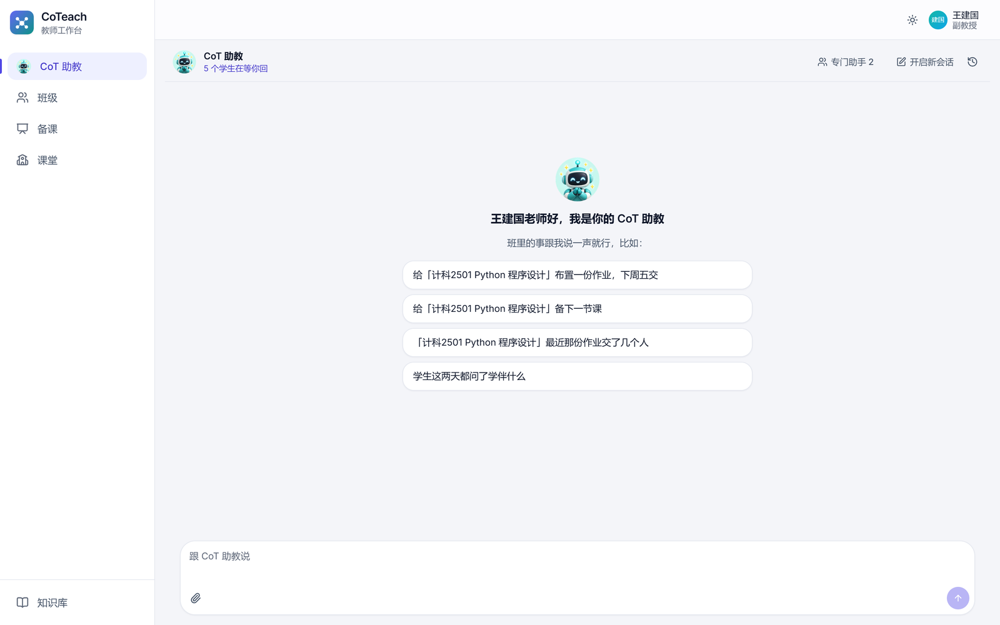
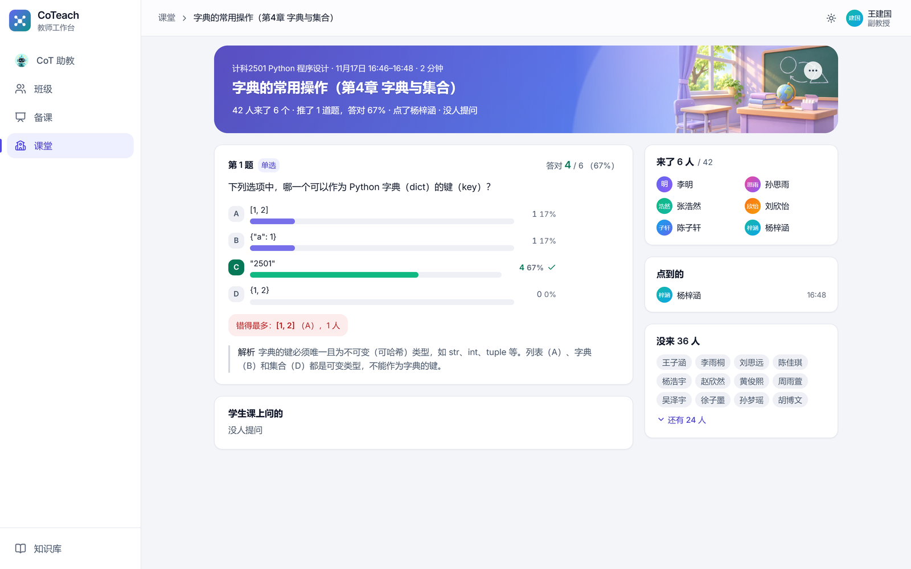

# CoTeach 师生多智能体协同教学系统 · 技术文档

第九届传智杯 AI WEB 网页开发挑战赛 · 省赛作品

## 一、要解决什么问题

大学和高职老师除了上课，还有一大堆跟每个学生打交道的活：回答学生的问题、布置作业、改作业、写讲评、看学生卡在哪、备下一节课、期末算分导教务。我们查了老师们自己说的痛点（调研报告在 `调研/老师痛点-2026-11-16.md`），最费时间的是写材料、备课、改作业；最闹心的是学生求分、学生不听课。证据最一致的一条红线是：不要让 AI 替老师打分，也不要让 AI 判学生作弊。

CoTeach 想做到的是：老师上课把该讲的讲完，资料或安排有变化时跟助教说一声，其余跟每个学生打交道的事由 AI 助教做，老师只在要拍板的时候点一下。

开发中，产品负责人把这件事分成三方，这条分工贯穿整个设计：

| 谁 | 做什么 |
|---|---|
| 老师 | 定课程内容、规矩和变化，上课讲课 |
| 程序 | 固定的步骤、要准的数：课程和名单、截止、收作业、谁交了、总分、成绩册、导出、谁能看到什么 |
| AI 助教 | 只做需要理解和判断的事：答疑、读学生的作业写批改和讲评、看学生卡在哪、整理资料、写教案 |

产品负责人原话：「这个不是程序就可以做吗」（指出管班、记分这类事不该交给 AI）。所以凡是要准的东西都由程序算，模型只写需要理解的部分。

## 二、功能一览

**老师那边**

- **CoT 助教**：说一句话就办事。比如「给计科2501 布置第四章作业，下周五交」「张浩然那题改成 25 分」「第三章交了几个人」。办完的事能撤回；拿不准用选项卡片问老师。
- **知识库**：老师交的 PDF、PPT、Word、图片、压缩包，助教读出来、整理成笔记，原件只读留着。打开就看得到每份笔记写了什么、从哪份原件来，最近整理了什么一件一句话。改动像 Word 修订一样显示，说「改回去」就撤回。
- **课程**：加课码和二维码，学生自己加入。课程页分四栏：作业、学情、成绩、成员。
- **批改和讲评**：助教照评分标准一项一项给分，在学生原文上划出问题；老师改了一份的某一项，同样问题的其他份可以一起改；讲评能下载 Word、发给学生。
- **学情**：学生卡在哪几个知识点，丢分多的在前，下节课怎么讲。只说卡在哪，不给学生贴标签。
- **专门助手**：同一类活反复出现时，助教提议分出一个专门助手，老师点「分出来」；以后这类活交给它，它的会话一直留着，老师改过它批的分它会记住。
- **备课**：说一句备哪个班、讲什么、几分钟，助教分几手做出学情、教案、课件、课堂练习、课后作业。课件每页是一张幻灯片，能放映，能导出 PPT 和 PDF；能直接改，也能跟助教说着改，改错了能撤回；课后作业点一下发到班里，带着评分标准。备的时候边做边显示，教案一段段写出来，课件一页页冒出来。
- **课堂**：上课时把练习题推到学生手机上，当场看谁答了、选了什么，能随机点名；下课自动公布答案和解析。

**学生那边**

- **CoT 学伴**：照课程资料包答疑，自己的作业、截止、分数现查。拿不准的问老师的助教；要老师定的事（晚交、改分、请假）在老师那边弹卡片，老师回了转告学生。
- **错题本和练一练**：各个班丢了分的题；点「练一练」，学伴照这道题出一道类似的新题，学生做完帮着判。

**登录**

- **登录密钥**：一个号一把，登录页贴上就进这个号，不用输账号密码；管理页能发、换、停用，库里只存哈希。比赛期间线上只开放给发了密钥的号和评委的号，登录页先给密钥，账号密码也能登，注册关着；自己部署默认还是账号密码。

### 界面

老师的 CoT 助教：空着的时候给几句能直接说的话，点一下放进输入框。



知识库：拖资料的地方，最近整理了什么一件一句话，每份笔记写了什么、从哪份原件来。


课程：每份作业一张卡片，一人一个小方块（批好、不及格、在批、拿不准、没交），一句话点名。


一份作业：助教拿不准的放在最上面，带着它的原话，下面一人一格摆分数；点开一份，原文上划出问题，旁边逐项得分。


学生来问的卡片：老师对话里，学生是谁、问的事、几个选项，点一下就答，也能自己回一句。


课程里的学情：卡在哪几个知识点，丢分多的在前，几个人丢分、几个人问过学伴，下节课怎么讲。


备课：说一句备哪节课，助教分几手做出学情、教案、课件、课堂练习、课后作业。做的时候边做边显示，顶上钉着一句助教说的话（这一张是课件排到第 15 页）。


课件：每页是模型照课件样式写的幻灯片，能直接改字、跟右边的助教说着改，能放映、导出 PPT。


课堂：下课后的小结，每道题几个人选了什么、错得最多的是哪个，谁来了、点了谁。



学生的错题本：各个班丢了分的题，点「练一练」让学伴出一道类似的新题。


## 三、架构设计

### 3.1 总体

```
浏览器（React 19 + Vite + Tailwind，TanStack Query）
   │  HTTP + SSE（助手一边干活一边推工作记录）
服务端（Node.js 24 + Hono，单进程）
   ├─ assistant/  CoT 助教、学伴、助教的另一手、课程资料包、传话
   ├─ grading/    批改、评分标准、讲评、学情（后台任务）
   ├─ prep/       备课：几手分头做教案、课件、题目，做成幻灯片、精修、核对、说着改
   ├─ classroom/  课堂：开课、推题、作答、点名、下课
   ├─ classes/    课程（代码里沿用 classes）、加课码、作业、成绩
   ├─ kb/         知识库（每位老师一个 Git 仓库）、交资料、整理助手
   └─ llm/        接模型：OpenAI / Anthropic / Gemini 写法，Gemini 接口
数据：SQLite（node:sqlite）＋ 每个知识库一个 Git 仓库（改动、撤回、历史）
```

一个数据目录同时只允许一个写进程（操作系统文件锁），启动时恢复中断的任务。

### 3.2 几个智能体和它们能碰什么

| 智能体 | 跟谁说话 | 工具（能做的事） | 看不到、做不了的 |
|---|---|---|---|
| CoT 助教 | 老师 | 30 个：建班、布置和改作业、改分、批改、写讲评、通知学生、回学生的问题、看学生问了什么、翻知识库、让后台整理知识库、开始备课、分出专门助手并把活交给它、撤回、重置学生密码等 | 学生之间的对话 |
| 专门助手（助教分出来的） | 助教（交活） | 翻知识库（search_kb、read_kb）；批交给它的作业 | 改课程、作业、成绩、名单；学生的东西 |
| 整理助手 | 老师（后台） | 在老师的知识库里读、写、改、看目录、查找；挪、删、存、交改动、撤回（ct 命令） | 知识库以外的文件；原件只读 |
| CoT 学伴 | 学生 | 查自己的作业和分数（my_homework）、发资料包里的文件（send_file）、问助教（ask_ta） | 答案、试卷、成绩册、名单、别人的作业 |
| 助教的另一手（helper） | 学伴 | 翻知识库、写课程资料包、给课程放文件、问老师（ask_teacher） | 改课程、作业、成绩；学生交的作业 |
| 批改、讲评、学情 | 无（后台） | 交批改（submit_grade）、存讲评、存学情、翻知识库 | 只看这一份作业或这一个班的数据 |
| 备课的几手 | 老师（在备课页说着改） | 翻知识库、存教案、存课件、把课件做成幻灯片（save_pages）、出题；核对和说着改时用改教案、改某页、插页、删页、改题的工具 | 只看这个班的数据和老师的知识库；不能发作业，发作业是老师点的 |

学生看不到什么，是程序拦住的，不靠提示词：
- 助教的另一手的知识库目录里，学生交的作业不列出来，读也读不到（`helper.ts` 的 `allowed`）。
- 学伴只能拿到资料包里老师给的文件。
- 发给学生的讲评由程序把同学的名字换成「有同学」（`review.ts` 的 `scrubNames`）。

### 3.3 老师、助教、学伴、学生之间怎么传话

```
学生 ──问──▶ CoT 学伴 ──拿不准──▶ 助教的另一手（翻知识库、看资料包）
                                        │能答：回学伴，学伴告诉学生
                                        │要老师定：老师的对话里弹一张卡片
老师 ◀──卡片（学生是谁、问的事、几个选项）──┘
老师点一个选项 ──▶ CoT 助教照老师的意思写给学生 ──▶ 送进学生的对话
                                        └─ 老师定的规矩写进课程资料包，下次同样的问题学伴直接照规矩答
```

每门课有一份「课程资料包」：建课程、布置作业时助教在后台写一段说明；作业的截止、满分、要求、附件由程序现取现拼，不让模型抄（抄过，抄错了星期几）。学伴答题以资料包为准。

### 3.4 批改：数字程序算，理由助教写

一份作业的批改分四步：
1. 布置作业时，助教照知识库里的题目和参考答案拟评分标准，每一项有分值和怎么给分；学生看不到。
2. 学生一交就排队批：模型用 submit_grade 交每一项的得分和理由，再加批注、评语，看不清时写上要老师看的原因。
3. 程序检查交上来的分数：每项卡在 0 到满分，总分自己加。批注要能在学生原文里找到才划线（不管空格换行）。
4. 老师改了一份的某一项，程序找出同样问题的其他几份，问老师要不要一起改。

交分的格式就是评分标准本身：评分标准有几项，交分就有几格，格子名就是项名。这是从一个真实的 bug 改出来的，见 4.4。

### 3.5 接模型：默认 Gemini，失败换 DeepSeek

- **模型层**（`server/src/llm/`）：统一的消息格式、工具调用和流式输出，下面接 OpenAI、Anthropic、Gemini 三种写法，加一个服务器本机的 Gemini 接口。
- **主模型和备用模型**：每次调用有一个主模型、一个备用模型。主模型报错、或者超过一段时间没动静，就换备用模型从头来。等多久按场景定：跟人对话的等 1 分钟，批改这类后台活等 5 分钟。
- **Gemini 接口不收工具**：服务器上的 Gemini 接口（Gemini 4 Hydrogen）是 OpenAI 写法，但不接受 tools 参数。我们在接法里把工具写进要求里，用 json_schema 要模型每一步交「要说的话（say）」和「要用的工具（calls）」，再拆成标准的工具调用。前面几步用过的工具写成同样的 JSON，工具的结果当成下一条消息。上层的助教代码不用改。
- **整理助手**：原来每一轮起一个 Claude Code 命令行，只能接 Anthropic 写法。现在改成服务里自己的循环，工具和规矩不变，换模型也不受影响。

### 3.6 助教的专门助手

- **什么时候分**：同一类活反复出现、每次要照同一套做法办时，助教自己分出一个（工具 new_specialist），写好名字、管什么、怎么办；老师也可以直接让它分。已经有管这类活的就交给那一个，不再分新的。提示词里不写任何例子，只写这条定义。
- **会话一直留着**：每个专门助手一段会话（agent_messages 里 spec:编号），只往后加，太长了压成概要；助教用 ask_specialist 把活交给它，它接着这段会话办，办完把结果交回。回学伴的那一手也能交给它（老师有专门助手时才多这个工具）。
- **批作业**：作业可以交给一个专门助手批。一份一份来的活，每份从它的会话往下接着批，批的那一份不留在会话里；老师改了它批的分（单份改或一起改），程序把「哪一项、几分改成几分、老师写的原因」记进它的会话，下一份照着批。
- **老师看得到、管得住**：助教页顶上「专门助手」能看到它们管什么、办过几次、批哪几份作业，能停用；作业页标着由谁批；分出来、改过的都能撤回。
- **量过才上线**：助教的尺子加 8 句（该分的分、查一次资料不分、有了交给它不再分、停用、改做法），原来 53 句同一个模型各量一遍，没有改坏。
- **助教自己提议**：程序数老师改分、回学生问题、跟助教说话的次数（各到 3、4、15 次，之后每多这么多再看一次），到了就让助教在后台回头看最近的记录。像是同一类活反复出现，就在老师的对话里放一张「助教的提议」卡片，老师点「分出来」或「先不用」。这一手只有一个工具（suggest_specialist），尺子 14 句对 13 句。

### 3.7 备课和课件

- **分几手做**：学情（这个班卡在哪）→ 教案 → 课件内容和题目两手同时做 → 核对（答案对不对、代码跑出来是不是说的结果、课件题目跟教案对不对得上）。哪一手失败了显示原因，能单独重来。
- **边做边显示**：
  - 模型交教案、课件、题目用的是工具调用，参数 JSON 是一个字一个字流出来的。接模型那一层（`server/src/llm/adapters/`）每 0.3 秒把写到一半的参数报一次；Gemini 接口那种整步 JSON 也一样报。这只是预览，不算模型已经出了内容，出错照样重试、换备用模型。
  - `server/src/llm/partial.ts` 读写到一半的 JSON：停在字符串里就补完这个字符串（写了一半的字也显示），不行就切回上一个写完的值，再补上括号解析。
  - 备课几手把读出来的教案、课件页、题目放进内存（`server/src/prep/live.ts`），取这节课时一起带上；幻灯片做好一批就存进课件。正在翻知识库时，记下在翻哪一份。
  - 页面 1.5 秒取一次：自动翻到正在做的那一份，跟着往下滚（老师自己一滚就不跟），顶上钉着一句助教用「我」说的话。课件内容写出来以前，先按教案的几个环节摆出骨架。
  - 量过：Gemini 写课件内容、出题、排版时多半是想好了一口气写完（出第一个字和写完只差半秒），这几步只能说一般要多久；教案、精修、核对改页时是真的边写边出。
- **做成幻灯片**：课件内容定了以后，另一手照一套课件样式把每页写成一段 HTML（一次五页，两件同时做）。样式说明（`server/src/prep/kit.ts`）发给模型，同一套 CSS（`web/src/components/deck/kit.ts`）给页面，类名一一对应，两边的说明一字不差。
- **精修**：程序量做出来的每一页：看得见的字、列表条数、代码行、表格行、卡片，代码行在它那一栏放不放得下。太满的页交回去一轮：只留学生要看的几句，其余挪进讲稿。只告诉它满在哪，数字不写给它。改前改后见 4.4。
- **显示和导出**：每页放在不许跑脚本的 iframe 里，存之前服务端再清洗一遍（去脚本、事件、外部资源）。字多了整页等比缩小；代码一行放不下先缩代码的字，不折行。导出 PPT 量出页面上每段字和每个色块，用 pptxgenjs 画成原生的文本框和形状，能接着改；导出 PDF 走浏览器打印。
- **改和撤回**：老师在页面上直接改字，或者跟助教说「第 5 页换个例子」，助教用改某页、插页、删页、改题这些工具改。每次改动存一版，能撤回；说着改的改了内容的那几页，再补做样子，并进同一版，撤回一次就都回去。课后作业发到班里时带上评分标准，交上来照它批。

### 3.8 课堂

- 老师在备好的课上点「上课」开一堂课，学生的学伴页面上出现上课卡片，点进去就算到课。
- 老师推一道课堂练习，学生在手机上作答；老师页面上每个选项几个人选，1.5 秒取一次最新的。随机点名从到课的学生里抽。
- 下课时还没公布的题一起公布，学生课后能看到答案和解析。数据在 lectures、lecture_questions、lecture_answers、lecture_calls、lecture_attendance 几张表里。

### 3.9 怎么约束 AI 写的代码

这个项目的代码由 AI（Claude Code）写，人定需求、看结果、拍板上线。约束靠这几样：

- **测试**：248 条，覆盖权限、课程和作业的流程、批改的打分规则、讲评、备课和课件的改动与撤回、课堂、知识库的改动和撤回、交资料、故障恢复、迁移。测试里模型的回答是写好的（`setModelStep` / `setKeeperStep`），不调真模型，每次结果一样。
- **类型检查**：前后端都开 TypeScript 严格检查。
- **尺子**：凡是改发给模型的话，先用尺子量（第四节），量完对比，没对比数据不上线。
- **上线前演练**：上线脚本先把线上数据备份一份，在副本上用新版本迁移、启动、检查，通过了才换；每次都留一条回退命令。
- **一次一块**：每做完一块就本地走一遍老师和学生两边、截图看，测试过了再提交、再上线。

## 四、意图控制策略

这一节讲两件事：产品负责人怎么把意图交给 AI，和我们怎么设计发给模型的话（提示词和上下文）。

### 4.1 产品负责人怎么把意图交给 AI

开发全程在一个对话里，产品负责人用平常的话说要什么，比如：

- 「我说的不止是在班级按钮里的啊，我是说左侧栏」
- 「资料不就是知识库的东西吗，作业不就是在班级里吗，学情也应该在班级里吧？」
- 「你不知道一般教学软件建班的操作页面是什么吗」
- 「这个会不会字太密太啰嗦了」

AI 照这几条规矩接：
1. **大一点的要求，先列清单再动手**：做什么、先做哪个、这次不做什么，等产品负责人一句「可以」再开始。
2. **先说自己的理解，再动手**：产品负责人用反问的口气提的时候，先把猜的意思说出来，等确认。
3. **常见的页面照主流平台的做法**：建课程、课程页、作业、成绩照课堂派、Google Classroom 的结构，不自己发明。
4. **只用平台上已有的数据**：比如不假设老师会上传期末成绩。
5. **做完自己先走一遍再说做完了**：老师、学生两个账号在本地从头到尾操作一遍，截图给产品负责人看。

这些规矩都是产品负责人在开发中一次次纠正出来的，对话记录在 `docs/ai-chats/`。

### 4.2 设计发给模型的话的几条原则

改任何发给模型的话（说明、工具描述、交给它的材料）之前，照「定目标」这套流程走：

1. **一次一个目标**：先用一句话说清产品负责人挑的是哪一类毛病，不是只修眼前那一个例子。
2. **先量再改**：定一把尺子，量出现在多少、目标多少。尺子先审自己：量的真是产品负责人说的那件事吗？
3. **找根，先删后加**：先查是不是我们自己写的哪句话造成的。第一个要试的改法是删；删不掉再换定义；加一句话是最后才考虑的。
4. **只动一处，带对照**：同样的材料、同样的模型，只改这一处，每组至少跑两遍，数字看，原文也读。
5. **数字不进提示词**：尺子只用来量。写进去它就去凑数。
6. **点名就招来**：说明里列举想要的东西，它就会照着堆。

每一次改动记在 `提示词账.md`：目标、尺子、改前改后的数字、改了哪句、删过哪些话。

### 4.3 上下文怎么给

- **说明短，数据由程序给**：几个助手的说明都只有几句话，讲身份和边界。要用的事实由程序现取，放进每一轮的上下文：课程资料包、作业的截止和满分、知识库目录、学情的人数，都不让模型自己记。
- **日期交给程序算**：「下周五」「往后推两天」照老师的原话交给程序换算（`assistant/time.ts`），模型不心算日期。
- **同一个班的开头一样**：资料包放在最前面，同一个班每次开头相同，命中缓存，又快又省钱。
- **对话太长就压**：超过一定长度，把前面的压成一段概要，留最近几十条原样。

### 4.4 几个改动的前后对比（数字都在提示词账里）

| 毛病 | 根在哪 | 怎么改 | 改前 → 改后 |
|---|---|---|---|
| 演示班 93 份批改里 13 份交错了题（学生第三章记成 27 分，评语却写「两题满分」） | 交分是随便几条的列表，每条写「第几项」。评分标准每道题底下又分（1）（2）（3）小项，模型按小项编号交，程序取了前三条 | 换定义：评分标准有几项交分就有几格，格子名就是项名 | 70 份交错 16 份、8 份 → 0 份、0 份（两遍），调用次数不变 |
| 学生来问的卡片太啰嗦 | 我们写的「问老师的话：谁、要什么、为什么」，加上让它带一段拟回复 | 先删拟回复，再把问题和选项换成跟助教平常问老师一样的写法 | 整张卡中位 487、414 字 → 200、191 字；转老师 6/6 都对 |
| 学伴动不动把学生的问题转给老师 | 资料包里写着「课上的知识」，它把「课上没讲到」当成「不能讲」 | 试过删词（中性，没采用）；最后加一句产品负责人 11-12 定过的原则「课上没讲到的知识点也照样讲」 | 不该转的转了 2 句、2 句 → 0、0；一般知识点转给助教 0/5 |
| 老师先说「建个计科5班」，又说「6班」，助教建了个叫「6班」的班 | 线上助教的思考是关着的 | 按产品负责人「开个中」打开思考（DeepSeek 没有中档，用高档） | 原样考 5 遍，关思考建错 2 遍 → 开思考 0 遍 |
| 助教把「下周五」算成这周五 | 日期是模型自己心算的 | 换定义：照老师原话写，程序换算 | 老师的 40 句里办对 35 → 38、37，日期错全没了 |
| 助教回话啰嗦，卡片上写着的又说一遍 | 我们写的「按常规定的项也告诉老师」，工具返回里又列了一遍 | 删掉这两处 | 把常规项再说一遍的回话 13/69、14/69 → 1/15 |
| 课件太满、太杂 | 课件内容那一手的「要点」没说讲解往哪放，讲解都写进了要点；做成幻灯片那一手只管样子，没人回头看满不满 | 换定义：要点一条一句短话，讲解写进讲稿；加一手程序量、太满的交回去精修 | 内容页字数中位 231 → 105，太满的页 12/14 → 2/13 |

### 4.5 产品负责人怎么引导 AI 修一个顽固的 bug（例子）

`docs/ai-chats/05-卡片啰嗦顺藤摸出批错.md` 是完整对话，过程是这样的：

1. 产品负责人截了一张老师对话里的学生卡片，问「这个会不会字太密太啰嗦了」。
2. AI 去查卡片上的字是哪几步写出来的，发现卡片里学生说的「第1题三条批注都判对了却扣了 3 分、评语说两题满分」是真的：线上演示班有 13 份批错了。
3. AI 先跟产品负责人说清这件更要紧，改了优先级。然后写了一把尺子：用线上那两份评分标准，把演示班 70 份答卷各批一遍，数交错题的份数。改前两遍分别错 16 份和 8 份，跟线上 13/93 对得上，说明尺子量得准。
4. 第一种改法（项名照抄）0 份交错，但模型第一次常常还是按小项交、被退回重交，调用多了一倍，没采用。第二种改法（照评分标准一格一格填）两遍都是 0 份，调用次数不变，采用。
5. 原来那把批改尺子再量一遍，确认别处没变差：分数段 16/16，两遍差 ≤5 分 8/8，评语里漏出参考答案从 3 遍降到 1 遍。
6. 上线以后，线上演示班 93 份全部重批，两份讲评重写，等产品负责人回的卡片按新写法重写。

## 五、可复现性论证

### 5.1 10 分钟跑起来

照 README 的「10 分钟复现」：装好 Node.js 24、pnpm 10、Git，`pnpm install`，把 DeepSeek 的 key 填进 `server/.env`，开两个终端分别 `pnpm dev:server`、`pnpm dev:web`，浏览器打开 http://localhost:5190。

整理助手不再依赖 Claude Code 命令行，除了 Node、pnpm、Git 不需要装别的。只配 DeepSeek 也能完整运行；Gemini 接口是可选的。

### 5.2 不调模型的部分：每次结果一样

`pnpm test` 有 248 条测试，测试里模型的回答是写好的，不连网，每次结果一样。覆盖：
- 权限：学生看不到什么、老师只能动自己的班；
- 流程：建班、加入、布置、交、批、退回、成绩册；
- 打分规则：每项卡在满分以内、总分程序加、批注定位、交错题的拒收；
- 学情：人数按编号数、名字换成「有同学」；
- 备课：几手都做完、页面上改、撤回、说着改、发作业带评分标准、太满的页精修；
- 课堂：开课、推题、作答、点名、下课公布答案；
- 知识库：改动、撤回、交资料、故障后恢复、迁移。

### 5.3 调模型的部分：用尺子量

模型每次回答不一样，所以用固定的世界、固定的题目，每组跑两遍，看数字的范围。尺子在 `tools/`，跑法写在 README 和每把尺子的文件开头：

| 尺子 | 题目 | 主要的数 |
|---|---|---|
| `ta-measure` | 老师跟助教说的 61 句（一件事、该问的、一句办几件、只问不办、撤回、办不了的、接上文） | 办对几句、办错几处、该问没问、不该问问了 |
| `stu-measure` | 学生跟学伴说的 34 句（自己的事、课程内容、要答案、转老师、照规矩、通知、闲聊、接上文、闭环） | 答对几句、漏给几句、该转没转、卡片字数 |
| `grade-measure` | 8 份好坏分明的答卷，每份批两遍 | 分数落没落在该落的段、两遍差多少、漏没漏参考答案 |
| `grade-map` | 演示班 70 份答卷，用线上那两份评分标准 | 交错题的份数 |
| `suggest-measure` | 老师最近的几组记录（该提议的、不该提议的） | 该提的提了几句、不该提的提了几句 |
| `prep-measure` | 几节课各真备一遍 | 每手用时、做没做成、教案环节和分钟、课件页数和版式、字多的页、题型、作业总分、选择题有没有答案 |
| `slide-measure` | 一份课件，照页面的画法每页放进 1280×720 | 放不下要缩多少、代码折不折行、字太小的页，拼一张总览图给人看 |

每把尺子在一份复制出来的数据里跑，不碰开发数据；跑前看余额，跑完记下调了几次模型、读写了多少。

换成 Gemini 4 Hydrogen 以后，学伴尺子 34 句对 33 句（DeepSeek 两遍是 34、33）。每句等的时间从中位约 15 秒变成 24 到 31 秒。

### 5.4 开发过程留下的东西

- **提交记录**：2026-11-16 晚上以前，开发时没有开 Git 仓库，每次改代码前留了带时间的源码备份。前 28 个提交是按这些备份的时间顺序还原的：提交时间就是那份备份的时间，提交说明写着还原自哪一份。之后的提交是边做边交的。
- **对话记录**：`docs/ai-chats/` 里有 6 段完整的对话，从产品负责人提要求到改好上线：
  1. 班级页照课堂派改；
  2. 助教「接上文」和开思考；
  3. 学伴和助教之间的桥；
  4. 批改、讲评和演示班；
  5. 卡片啰嗦，顺藤摸出批错的作业；
  6. 换模型，加学情、错题本、备课。
- **提示词账**：`提示词账.md`，每一次改发给模型的话都有记录。
- **演示数据**：演示班的 36 份答卷由 `tools/demo-class/gen.ts` 按每个学生的水平事先生成（`server/src/demo/answers.json`），建班、批改、讲评、学伴提问都是真跑的；放一个 `seed-demo.json` 就能在任何一台机器上重建。

## 六、边界

- AI 只做初评，老师随时能改分；判不了的留给老师看，不直接发给学生。
- 不给学生贴「学困生」「风险」这类标签，不估「掌握度百分比」；学情只说卡在哪。
- 答案、试卷、成绩册、名单、别人的作业，学生那边由程序拦住。
- 模型的 key 只存在服务器的加密字段和环境变量里，不进代码、不进日志、不进命令行。
