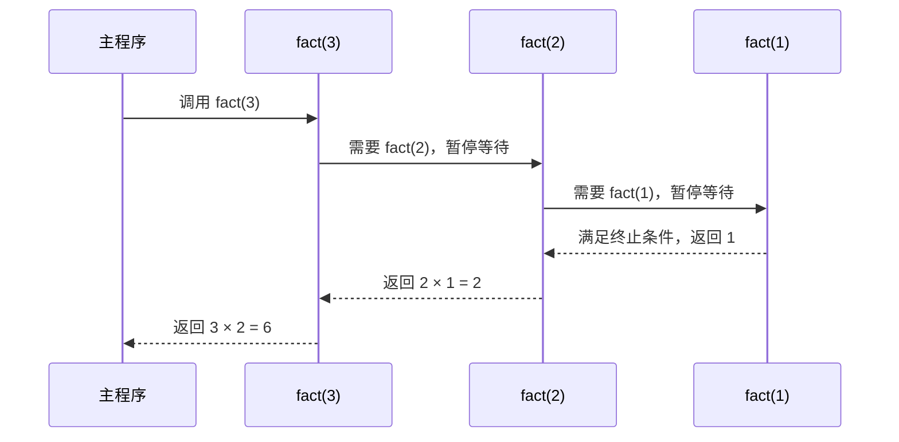

# 递归与调用栈 · 教学设计

## 一、课题信息

| 项目 | 内容 |
| --- | --- |
| 课程 | Python 程序设计 |
| 课题 | 递归与调用栈（第7章 递归） |
| 授课班级 | 计科2301班（计算机科学与技术2023级） |
| 上课安排 | 周二 1-2 节（教学楼A302）· 周四 5-6 节（实验楼B301） |
| 课时 | 90 分钟 |

## 二、教学目标

**知识目标**
- 能复述函数调用时参数传递与作用域查找（LEGB）的基本机制，为理解递归的调用过程做铺垫。
- 能说明递归的两个必要组成部分：**基例（base case）** 和 **递归例（recursive case）**，并解释「调用栈」中栈帧的压入与弹出过程。
- 能用调用栈图（栈帧示意图 / mermaid 时序图）描述 `fact(3)`、`sum(n)` 等简单递归函数的执行过程。

**能力目标**
- 能独立编写包含正确终止条件的递归函数（如求和、阶乘、汉诺塔 n=3），并能画出对应的调用栈变化图。
- 能对给定的错误递归代码（漏写终止条件、终止条件写错位置、忘记 return）进行调试与改正。

**素养目标**
- 在分析递归执行过程中养成「先想终止、再想递推」的严谨思维习惯。
- 通过汉诺塔等经典问题体会递归思想化繁为简的美感，增强解决复杂问题的信心。

## 三、学情分析

结合班级学情数据，本次课需要重点关注以下几点：

- **函数基础薄弱**：函数掌握度仅 61%（9人薄弱）、参数传递 63%（6人）、作用域 67%（5人）。这说明相当一部分同学在进入递归学习之前，对「函数调用时发生了什么」本身理解就不牢固，直接讲递归很容易听不懂，因此必须先用 5 分钟专门衔接复习。
- **递归本身掌握度 65%（9人薄弱）**，且第6章测验均分 71.8/90（约 79.8%），第5章成绩尚未出，整体学习状态处于中等偏下，需要放慢节奏、多用可视化手段。
- **典型错误集中在**：递归执行过程理不清、终止条件与 return 的关系混乱、调用栈概念模糊；汉诺塔（n=3）错误率高达 7 人；此外还有函数章节遗留问题（列表被意外修改、默认可变参数累加错误）容易在递归中复现（如递归函数误用可变默认参数做累加器）。
- **需要重点关注的学生**：贺涛（73→30，下滑明显）、刘洋（3次未交作业）、赵一鸣（68→42）、孙浩（89→54，且9天未登录，需课后单独联系）、郑明轩（80→50）。课堂提问与巡视练习环节要优先关注这几位同学的状态。

综合以上，教学设计遵循学情简报建议：**先复习调用机制 → 用调用栈图示讲透执行过程 → 强调"先写终止条件再写递归调用" → 求和与汉诺塔（n=3）作为主线案例 → 改错练习巩固**。

## 四、教学重点与难点

| 类别 | 内容 | 突破策略 |
| --- | --- | --- |
| 重点 | 递归的两要素：基例与递归例；调用栈中栈帧的压入/弹出过程 | 用 mermaid 时序图 + 手绘栈帧图逐层展示 `fact(3)` 执行过程，配合「代码实验室」逐步执行 |
| 重点 | 递归函数的设计顺序：先确定终止条件，再写递归调用 | 强调口诀「先写终止再 return，递归调用退一步」，板书固定模板 |
| 难点 | 递归执行时「递推」与「回归」两阶段的理解，尤其是回归阶段结果如何逐层带回 | 用求和函数 `sum_to(n)` 作为最简案例，画出每一层等待结果的箭头图，再过渡到汉诺塔 |
| 难点 | 汉诺塔（n=3）问题的递归分解思路 | 先用实物/图示演示 n=1、n=2 手动搬动过程，再抽象出「把 n-1 个盘子搬到辅助柱」的递归结构，画出调用树 |
| 难点 | 函数作用域遗留问题在递归中的复现（如递归函数误用可变默认参数累加） | 结合《第6章》作用域案例，展示"函数内赋值即局部变量"规则，并给出改错练习 |

## 五、教学过程

| 环节 | 时间 | 教师活动 | 学生活动 | 设计意图 |
| --- | --- | --- | --- | --- |
| 一、复习衔接：函数调用与作用域 | 5 分钟 | 【讲授+提问】快速回顾函数调用三要素（定义→调用→return），提问「`area(3,4)` 调用时，`width`、`height` 是谁的变量？函数结束后还在吗？」；结合《第6章》`increase(count)` 案例追问 LEGB 查找顺序与 `UnboundLocalError` 成因 | 口头回答、回忆上节课内容 | 针对函数61%、作用域67%的薄弱现状，先打通"调用即产生局部空间"的认知，为理解调用栈铺路 |
| 二、情境导入：从「重复调用」到「自己调用自己」 | 8 分钟 | 【讲授+讨论】提出问题：「如何求 1+2+...+100？」先用循环写法回顾，再抛出「能不能让函数在自己内部调用自己？」引出递归概念；展示生活/专业类比（俄罗斯套娃、文件夹嵌套查找子文件夹） | 思考并讨论类比是否合理，尝试口头描述"自己调用自己"会不会停不下来 | 用熟悉情境降低抽象感，同时预埋"如果不停下来会怎样"的问题，引出终止条件的必要性 |
| 三、新知讲授一：递归的两要素与代码模板 | 10 分钟 | 【讲授】给出递归定义与结构：基例（不再递归、直接返回）+ 递归例（调用自身，规模变小）；板书固定模板并强调口诀「先写终止再 return」；用 `sum_to(n)` 求和函数作为最小案例现场编写 | 跟随板书记录模板，在笔记本上模仿写出 `sum_to(n)` | 针对递归65%薄弱的现状，用最简单的求和案例建立"基例+递归例"的结构化认知，避免一上来就用阶乘/汉诺塔造成认知负荷 |
| 四、新知讲授二：调用栈可视化——栈帧压入与弹出 | 15 分钟 | 【演示】以《第7章》`fact(3)` 为例，结合 mermaid 时序图逐步讲解：每次调用压入一个栈帧（保存本次 n 和局部变量），到达基例后开始弹出、逐层带回结果；边讲边画栈帧堆叠图（下宽上窄的"积木"图）；用「代码实验室」执行可视化功能逐帧展示 | 观察演示，跟随教师节奏在笔记上画出自己的栈帧堆叠图，标注每层的 n 值 | 突破重点难点：把抽象的"递推-回归"过程转化为可视的栈帧图，帮助学生建立空间化的执行模型 |
| 五、师生共练：用调用栈图分析 sum_to(3) | 8 分钟 | 【练习+提问】要求学生独立画出 `sum_to(3)` 的调用栈图（压入几层？每层等待什么？何时开始返回？），巡视时重点关注贺涛、赵一鸣、郑明轩等基础薄弱同学 | 独立在纸上/白板画图，同桌互查，被抽点的同学上台讲解自己画的栈帧图 | 让学生亲手画图内化"递推-回归"过程，教师借此环节精准定位理解盲点，及时个别辅导 |
| 六、新知讲授三：经典问题——汉诺塔（n=3） | 15 分钟 | 【讲授+演示】先用实物或图示演示 n=1、n=2 的手动搬动过程；引导学生发现规律：搬 n 个盘子 = 搬 n-1 个到辅助柱 + 搬第 n 个到目标柱 + 搬 n-1 个到目标柱；现场编写代码并用调用栈/调用树图展示 n=3 的完整执行过程 | 观察实物演示，参与规律讨论，跟随讲解理解递归分解思路，记录调用树图 | 针对汉诺塔错误率高（7人）的情况，用"手动演示→发现规律→抽象递归"的渐进方式降低理解门槛，避免直接给代码造成"记忆而非理解" |
| 七、易错点专项讲解：漏写return、可变默认参数 | 10 分钟 | 【讲授+讨论】展示典型错误代码（递归函数漏写 return、终止条件写在错误位置导致无限递归、误用可变默认参数做累加器致列表被意外修改），逐一分析报错现象与栈溢出（RecursionError）表现 | 观察报错演示，讨论错误原因，尝试口头给出修改方案 | 直接对应学情简报"漏return、可变默认参、改列表"的典型错误，结合作用域知识串联讲解，强化"函数内状态不会自动保留"的认知 |
| 八、课堂练习 | 15 分钟 | 【练习】布置分层练习：基础题（补全 `fact`/`sum_to` 递归代码）、提升题（画出 `fib(4)` 的调用栈图）、拓展题（改错：找出汉诺塔代码中的 bug）；巡视答疑，重点关注需关注学生名单 | 独立或小组完成练习，遇到困难先讨论再举手提问 | 通过分层练习兼顾不同水平学生，用即时反馈检验本节课重点难点的掌握情况 |
| 九、小结与作业布置 | 4 分钟 | 【讲授】用一张调用栈图串讲全课：函数调用（复习）→ 递归的两要素 → 栈帧压入弹出 → 汉诺塔应用；布置课后作业并说明提交要求 | 齐声回顾本课关键词，记录作业要求 | 强化知识结构、明确课后任务，同时提醒长期未交作业/未登录的同学（刘洋、孙浩）及时完成 |

时间核对：5 + 8 + 10 + 15 + 8 + 15 + 10 + 15 + 4 = **90 分钟** ✓

## 六、调用栈演示图示（用于课上讲解）



栈帧堆叠图（板书用，配合上图讲解）：

```
调用栈从下往上生长：
┌─────────────┐  ← 最后压入，最先弹出
│ fact(1) n=1 │     基例，直接返回 1
├─────────────┤
│ fact(2) n=2 │     等待 fact(1) 结果
├─────────────┤
│ fact(3) n=3 │     等待 fact(2) 结果
├─────────────┤
│   主程序     │     最先压入，最后弹出
└─────────────┘
```

配套代码：

```python
def fact(n):
    """计算 n 的阶乘，递归实现"""
    if n == 1:          # 基例：终止条件
        return 1
    return n * fact(n - 1)   # 递归例：规模变小，调用自身

print(fact(3))   # 6
```

## 七、板书设计

```
                    递归与调用栈
┌─────────────────┬──────────────────────┬─────────────────┐
│  一、复习：函数调用  │   二、递归的两要素        │  三、调用栈       │
│  def→调用→return  │   1. 基例（终止条件）     │  每次调用 = 压栈    │
│  形参/实参        │   2. 递归例（自身调用，   │  每次返回 = 出栈    │
│  局部变量作用域    │      规模变小）          │  递推↓  回归↑     │
│  (LEGB)          │                        │                  │
├─────────────────┴──────────────────────┴─────────────────┤
│  代码模板：                                                  │
│  def f(n):                                                  │
│      if <终止条件>:      # 先写终止！                          │
│          return <基例值>                                     │
│      return <n与f(更小规模)的组合>   # 再写递归                  │
├──────────────────────────────────────────────────────────┤
│  案例：fact(3) 栈帧图（见右侧手绘） | 汉诺塔(n=3)：              │
│                                    move(n-1,A,C,B)             │
│                                    move(1,A,B,C)               │
│                                    move(n-1,C,B,A)             │
├──────────────────────────────────────────────────────────┤
│  易错点：① 漏写return ② 终止条件位置错 ③ 可变默认参数误用累加      │
└──────────────────────────────────────────────────────────┘
```

## 八、课堂练习与课后作业

### 课堂练习（随堂完成，15分钟）

**1. 基础题：补全递归求和函数**

```python
def sum_to(n):
    """递归求 1 到 n 的和"""
    if n == 1:
        return ____        # 补全基例
    return ____             # 补全递归例

print(sum_to(5))   # 期望输出 15
```

**2. 提升题：画出调用栈图**

请画出 `fib(4)` 的调用栈图（提示：斐波那契递归会分叉，注意每个分支的压入与弹出顺序）：

```python
def fib(n):
    if n <= 1:
        return n
    return fib(n - 1) + fib(n - 2)
```

**3. 拓展题：找出汉诺塔代码中的 bug**

```python
def hanoi(n, source, target, auxiliary, moves=[]):   # bug 提示：默认参数为可变对象
    if n == 1:
        moves.append(f"{source} -> {target}")
    else:
        hanoi(n - 1, source, auxiliary, target, moves)
        moves.append(f"{source} -> {target}")
        hanoi(n - 1, auxiliary, target, source, moves)
    return moves

print(hanoi(3, "A", "C", "B"))
print(hanoi(2, "A", "C", "B"))   # 第二次调用结果异常，为什么？
```

要求：说明第二次调用为什么结果不对，并给出修改方案。

### 课后作业

1. **编程题**：用递归实现求一个正整数的各位数字之和（如 `digit_sum(1234)` 返回 `10`），并写出对应的基例与递归例。
2. **绘图题**：手绘 `fact(4)` 完整的调用栈图，标注每一层的 `n` 值和返回值，递推与回归阶段各用不同颜色箭头标出。
3. **改错题**（对应《常见错误与调试技巧手册》）：给出 3 段包含"漏写return""终止条件位置错误""可变默认参数累加错误"的递归代码，要求找出并修改错误，写出修改理由。
4. **思考题**：汉诺塔问题若 n=4，共需要搬动多少次？请用递归公式推导（不要求写代码），并说明公式与递归结构的对应关系。

> 提醒：刘洋、孙浩请务必按时提交本次作业；孙浩已连续9天未登录学习平台，建议课后主动联系其了解学习情况。

## 九、教学反思

（留空，供课后填写）