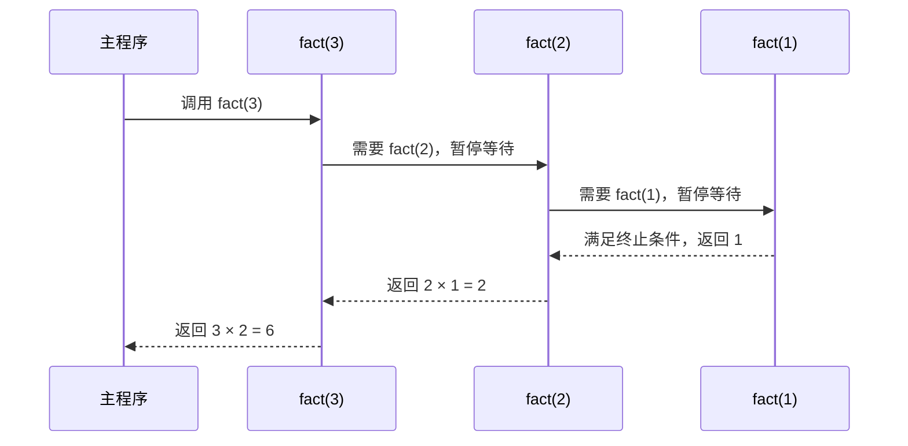

# 第7章 递归

## 7.1 什么是递归

**递归**是指函数在执行过程中**调用它自己**。递归的思想是：把一个大问题拆成**规模更小的同类问题**，直到问题小到可以直接给出答案。

生活中的例子：排队时想知道自己是第几个，可以问前面的人「你是第几个？」，前面的人再问他前面的人……直到问到第一个人，他直接回答「我是第 1 个」，然后答案一层层传回来，每个人在前一个人的答案上加 1。

## 7.2 递归的两个要素

一个正确的递归函数必须同时具备：

1. **终止条件（递归出口 / 基准情况）**：问题规模足够小时，直接返回结果，不再递归。
2. **递推关系（递归调用）**：把问题转化为规模更小的同类问题，并且每次调用都**向终止条件靠近**。

以阶乘为例：$n! = n \times (n-1)!$，且 $1! = 1$。

```python
def fact(n):
    if n <= 1:              # 终止条件
        return 1
    return n * fact(n - 1)  # 递推关系：规模从 n 缩小到 n-1

print(fact(5))   # 120
```

## 7.3 递归是怎样执行的：调用栈

每调用一次函数，系统就在**调用栈**中压入一个新的「栈帧」，保存这次调用的参数和局部变量；函数返回时，栈帧弹出。`fact(3)` 的执行过程如下：



可以看到递归分为两个阶段：

- **递推（下去）**：不断调用自身，栈越来越深，每一层都在「等待」下一层的结果；
- **回归（回来）**：到达终止条件后，结果逐层返回，每一层完成自己剩下的计算。

> 在「代码实验室」中把上面的代码粘贴进去，点击「执行可视化」，可以一步步看到每一层 `fact` 的 `n` 值以及栈帧的压入和弹出。

## 7.4 常见错误

### 1. 缺少终止条件或永远到不了终止条件

```python
def fact(n):
    return n * fact(n - 1)     # 没有出口
```

程序会一直递归，直到超过最大递归深度（默认约 1000 层），报错 `RecursionError: maximum recursion depth exceeded`。

另一种情况是递归调用**没有向出口靠近**，例如 `fact(n)` 里写成了 `fact(n)` 或 `fact(n + 1)`。

### 2. 忘记 return 递归结果

```python
def fact(n):
    if n <= 1:
        return 1
    n * fact(n - 1)     # 计算了但没有返回，结果是 None
```

### 3. 终止条件不完整

例如斐波那契数列中只写 `if n == 1: return 1`，那么 `fib(2)` 会调用 `fib(0)` 和 `fib(1)`，而 `fib(0)` 会继续调用 `fib(-1)`……永远到不了出口。

## 7.5 经典例题

### 斐波那契数列

```python
def fib(n):
    """第 n 项（fib(1) = fib(2) = 1）"""
    if n <= 2:
        return 1
    return fib(n - 1) + fib(n - 2)
```

这种写法简洁但存在大量**重复计算**：`fib(5)` 会计算两次 `fib(3)`、三次 `fib(2)`……时间复杂度约为 $O(2^n)$，n = 40 时已经非常慢。可以用「记忆化」保存已算过的结果：

```python
from functools import lru_cache

@lru_cache(maxsize=None)
def fib(n):
    if n <= 2:
        return 1
    return fib(n - 1) + fib(n - 2)
```

### 汉诺塔

把 n 个盘子从 A 柱借助 B 柱移到 C 柱，每次只能移动一个盘子，大盘不能压在小盘上。

思路：要移动 n 个盘子，可以先把上面 n-1 个从 A 移到 B（借助 C），再把最大的盘子从 A 移到 C，最后把 n-1 个从 B 移到 C（借助 A）。

```python
def hanoi(n, src, mid, dst):
    if n == 1:
        print(f"{src} -> {dst}")
        return 1
    steps = hanoi(n - 1, src, dst, mid)
    print(f"{src} -> {dst}")
    steps += 1
    steps += hanoi(n - 1, mid, src, dst)
    return steps

total = hanoi(3, "A", "B", "C")
print("共", total, "步")   # 共 7 步，一般地需要 2^n - 1 步
```

### 数字各位之和

```python
def digit_sum(n):
    if n < 10:
        return n
    return n % 10 + digit_sum(n // 10)
```

## 7.6 递归还是循环

| 对比 | 递归 | 循环（迭代） |
| --- | --- | --- |
| 代码 | 贴近数学定义，简洁 | 通常更长，需要自己维护状态 |
| 效率 | 有函数调用开销，可能重复计算 | 一般更快、更省内存 |
| 深度限制 | 受最大递归深度限制 | 无此限制 |
| 适用问题 | 树、分治、回溯等天然递归的结构 | 简单的重复计算 |

一般建议：**问题本身具有递归结构**（如树的遍历、汉诺塔、全排列、归并排序）时用递归；简单的累加、计数用循环。

## 7.7 如何设计递归函数：三步法

1. **定义函数的含义**：明确 `f(n)` 表示什么、返回什么（例如「返回前 n 个盘子的移动步数」）。
2. **找出口**：最小规模的问题答案是什么？
3. **找递推**：假设 `f(n-1)` 已经能正确工作（「信任递归」），如何用它得到 `f(n)`？

> 学递归最忌讳「在脑子里展开每一层」。只要出口正确、每一步都向出口靠近、递推关系正确，递归就一定正确。

## 7.8 本章小结

- 递归 = 终止条件 + 向终止条件靠近的递推关系。
- 递归执行依赖调用栈：先层层深入，再逐层返回。
- 常见错误：无出口、忘记 return、出口不完整、重复计算。
- 用「三步法」设计递归，用执行可视化观察调用栈的变化。
